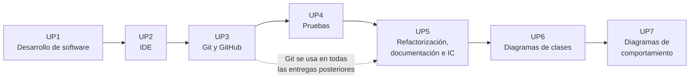

# Entornos de Desarrollo

**Módulo profesional 0487** · CFGS Desarrollo de Aplicaciones Web (DAW) · 1.^er^ curso · Modalidad semipresencial · 96 horas (3 h/semana)

Este sitio reúne la programación, los apuntes y las tareas del módulo. Está organizado en **siete unidades de programación (UP)**, y cada una trabaja uno o varios **resultados de aprendizaje (RA)** del currículo.

## Mapa del módulo

| UP | Título | RA | Horas | Evaluación |
|:--:|--------|:--:|:-----:|:----------:|
| [UP1](up1/index.md) | Desarrollo de software y metodologías ágiles | RA1 | 9 | 1.ª |
| [UP2](up2/index.md) | Entornos de desarrollo integrados | RA2 | 9 | 1.ª |
| [UP3](up3/index.md) | Control de versiones y trabajo colaborativo | RA4 (f, h) | 15 | 1.ª |
| [UP4](up4/index.md) | Diseño y realización de pruebas | RA3 | 21 | 2.ª |
| [UP5](up5/index.md) | Refactorización, documentación e integración continua | RA4 (a–e, g, i) | 15 | 2.ª |
| [UP6](up6/index.md) | Diagramas de clases | RA5 | 15 | 3.ª |
| [UP7](up7/index.md) | Diagramas de comportamiento | RA6 | 12 | 3.ª |

## Por qué este orden

- **Git va pronto.** Desde la UP3, todas las tareas se entregan en un repositorio, así que el control de versiones se practica durante todo el curso y no solo en su unidad.
- **Las pruebas van antes de refactorizar.** Para refactorizar con garantías hacen falta pruebas automáticas que demuestren que el comportamiento no cambia (RA4 b). Por eso la UP4 (pruebas) precede a la UP5.
- **UML se trata en dos unidades:** estructura (clases, RA5) y comportamiento (RA6), con la misma herramienta y el mismo caso práctico.

## Cómo usar este sitio

1. Empieza por la [Guía del módulo](modulo/index.md): ahí están la metodología semipresencial, la evaluación y las rúbricas.
2. Cada UP tiene una **página de presentación** con los RA y criterios que trabaja, la temporización, los contenidos y las tareas evaluables.
3. Las **tareas** indican qué hay que entregar, dónde y con qué rúbrica se califican.

!!! info "Lenguaje y herramientas de referencia"
    Java 25 (LTS) · IntelliJ IDEA y Visual Studio Code · Git y GitHub · Maven · JUnit 6 y Mockito · Mermaid y PlantUML. Los detalles de instalación están en [Entorno de trabajo](modulo/entorno-de-trabajo.md).
