# Temporización

La planificación se expresa en **semanas lectivas** (de la 1 a la 32) y **horas**: 96 horas en total, a 3 horas por semana. Las fechas concretas del curso 2026-27 se añadirán cuando se publique el calendario del centro.

!!! warning "Pendiente"
    Fechas de inicio y fin de cada evaluación, semanas de exámenes y festivos del curso 2026-27.

## Distribución por unidades

| UP | Título | RA | Semanas | Horas | Evaluación |
|:--:|--------|:--:|:-------:|:-----:|:----------:|
| UP1 | Desarrollo de software y metodologías ágiles | RA1 | 1–3 | 9 | 1.ª |
| UP2 | Entornos de desarrollo integrados | RA2 | 4–6 | 9 | 1.ª |
| UP3 | Control de versiones y trabajo colaborativo | RA4 (f, h) | 7–11 | 15 | 1.ª |
| UP4 | Diseño y realización de pruebas | RA3 | 12–18 | 21 | 2.ª |
| UP5 | Refactorización, documentación e integración continua | RA4 (a–e, g, i) | 19–23 | 15 | 2.ª |
| UP6 | Diagramas de clases | RA5 | 24–28 | 15 | 3.ª |
| UP7 | Diagramas de comportamiento | RA6 | 29–32 | 12 | 3.ª |
| | **Total** | | **32** | **96** | |

## Horas y peso de cada RA

El peso de cada RA en la nota final es **proporcional a las horas** que se le dedican (redondeado para sumar 100 %).

| RA | Unidades | Horas | % de horas | **Peso en la nota** |
|:--:|----------|:-----:|:----------:|:-------------------:|
| RA1 | UP1 | 9 | 9,4 % | **9 %** |
| RA2 | UP2 | 9 | 9,4 % | **9 %** |
| RA3 | UP4 | 21 | 21,9 % | **22 %** |
| RA4 | UP3 + UP5 | 30 | 31,3 % | **31 %** |
| RA5 | UP6 | 15 | 15,6 % | **16 %** |
| RA6 | UP7 | 12 | 12,5 % | **13 %** |
| | | **96** | 100 % | **100 %** |

```mermaid
gantt
    title Planificación por semanas lectivas
    dateFormat X
    axisFormat %s
    section 1.ª evaluación
    UP1 Desarrollo de software   :0, 3
    UP2 Entornos de desarrollo   :3, 6
    UP3 Control de versiones     :6, 11
    section 2.ª evaluación
    UP4 Pruebas y depuración     :11, 18
    UP5 Refactorización, doc. e IC :18, 23
    section 3.ª evaluación
    UP6 Diagramas de clases      :23, 28
    UP7 Diagramas de comportamiento :28, 32
```

## Pruebas presenciales

| Evaluación | Al final de | RA que se evalúan |
|:----------:|-------------|-------------------|
| 1.ª | UP3 (semana 11) | RA1, RA2 y RA4 (parte f, h) |
| 2.ª | UP5 (semana 23) | RA3 y RA4 (parte a–e, g, i) |
| 3.ª | UP7 (semana 32) | RA5 y RA6 |
| Ordinaria | Fecha que fije el centro | RA no superados |
| Extraordinaria | Fecha que fije el centro | Todos los RA del módulo |

## Ritmo quincenal (semipresencial)

Cada bloque de dos semanas sigue la misma pauta:

1. **Publicación**: apuntes y tarea del bloque, al inicio de la quincena.
2. **Tutoría colectiva 1**: explicación de los conceptos clave y práctica guiada.
3. **Trabajo autónomo**: lectura, ejemplos y desarrollo de la tarea, con dudas en el foro.
4. **Tutoría colectiva 2**: revisión de dudas frecuentes y avance de la tarea.
5. **Entrega**: al final de la quincena, en Aules y en el repositorio.
