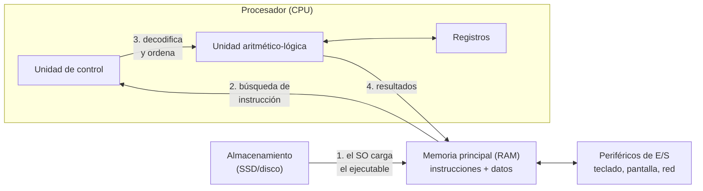

# 1. Programas y sistema informático

## Hardware y software

Un sistema informático tiene una parte física, el **hardware** (procesador, memoria, almacenamiento, periféricos), y una parte lógica, el **software**: los programas, los datos que manejan y su documentación.

El software tiene rasgos que lo distinguen de otros productos de ingeniería:

- **Es intangible.** No se desgasta con el uso, pero sí se deteriora cuando se modifica sin cuidado.
- **Se desarrolla, no se fabrica.** El coste está en diseñarlo y construirlo; copiarlo no cuesta casi nada y la copia es idéntica al original.
- **Cambia constantemente.** Hay que adaptarlo a nuevos requisitos, sistemas y usuarios durante toda su vida útil.
- **Puede ser a medida o estándar.** Se construye para un cliente concreto o se distribuye para muchos usuarios.

## Programa y aplicación

Un **programa** es un conjunto ordenado de instrucciones que el ordenador ejecuta para hacer una tarea concreta. Una **aplicación** es un conjunto de programas, bibliotecas y datos que, juntos, resuelven una necesidad del usuario (una tienda en línea, un gestor de notas, un editor de vídeo).

El *firmware* es un caso especial: software grabado en memoria no volátil de un dispositivo (la BIOS/UEFI de una placa base, el programa de un router) que controla directamente el hardware.

## Qué ocurre cuando se ejecuta un programa

El modelo de **Von Neumann**, base de casi todos los ordenadores actuales, explica cómo colaboran los componentes:

1. El programa está guardado en el **almacenamiento** como un fichero ejecutable.
2. Al lanzarlo, el **sistema operativo** crea un proceso, reserva memoria y copia en la **RAM** las instrucciones y los datos iniciales.
3. El **procesador** repite el ciclo de instrucción: *buscar* la siguiente instrucción en memoria, *decodificarla* y *ejecutarla* (cálculos en la ALU, movimientos entre registros y memoria).
4. Para leer el teclado, escribir en pantalla o acceder a la red, el programa pide al sistema operativo que use los **periféricos** mediante llamadas al sistema.

!!! example "Relación programa–hardware en un ejemplo"
    En `NotasEstructurado.java`, las variables `n1`, `n2` y `n3` ocupan posiciones de memoria. `calcularMedia` se traduce en instrucciones de suma y división que ejecuta la ALU. `sc.nextDouble()` espera a que el sistema operativo entregue lo que se escribe en el teclado (un periférico de entrada). `System.out.println` envía texto a la pantalla (periférico de salida).

## Memoria de un proceso

Mientras se ejecuta, un programa organiza su memoria en zonas con usos distintos:

| Zona | Contenido | Ejemplo en Java |
|------|-----------|-----------------|
| Código | Instrucciones del programa | *bytecode* y código máquina generado por la JVM |
| Pila (*stack*) | Variables locales y llamadas a funciones en curso | `n1`, `media`, la llamada a `calcularMedia` |
| Montículo (*heap*) | Objetos creados dinámicamente | el objeto `Scanner`, los `String` |
| Datos estáticos | Variables globales o de clase | atributos `static` |

En Java, el **recolector de basura** libera automáticamente los objetos del montículo que ya no se usan. En C, en cambio, es el programador quien reserva y libera memoria (`malloc`/`free`).

## Para practicar

- Abre el administrador de tareas (o `top`/`htop` en Linux) mientras ejecutas un programa Java que espera una entrada por teclado. Localiza el proceso `java` y observa la memoria que ocupa.
- ¿Qué componentes del ordenador intervienen cuando un programa lee un fichero del disco y muestra su contenido?
