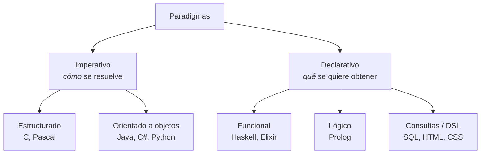

# 2. Lenguajes y paradigmas

Un **lenguaje de programación** es un lenguaje artificial, con una sintaxis (reglas de escritura) y una semántica (significado) precisas, que permite expresar algoritmos para que un ordenador los ejecute después de traducirlos a código máquina.

## Elementos comunes

Casi todos los lenguajes comparten estos elementos:

- **Identificadores** y **palabras reservadas** (`class`, `if`, `while`).
- **Tipos de datos**: primitivos (enteros, reales, carácter, lógico) y compuestos (*arrays*, registros, colecciones, objetos).
- **Constantes y variables**: zonas de memoria con nombre cuyo valor no cambia o sí puede cambiar.
- **Operadores**: aritméticos, relacionales, lógicos, de asignación…
- **Expresiones**: combinaciones de operandos y operadores que producen un valor.
- **Instrucciones**: de entrada y salida, de asignación y de control (secuencia, selección e iteración).
- **Comentarios**: texto para las personas que el traductor ignora.

## Generaciones

| Generación | Época | Características | Ejemplos |
|:----------:|-------|-----------------|----------|
| 1.ª | Años 40–50 | Código máquina binario, propio de cada procesador | `10110000 01100001` |
| 2.ª | Años 50 | Ensamblador: mnemónicos equivalentes a instrucciones máquina | `MOV AL, 61h` |
| 3.ª | Desde 1957 | Alto nivel, independientes de la máquina | Fortran, COBOL, C, Java, Python |
| 4.ª | Años 80 | Orientados a un dominio, más declarativos | SQL, generadores de informes |
| 5.ª | Años 80–90 | Resolución de problemas mediante restricciones y lógica (IA simbólica) | Prolog |

## Clasificaciones

### Según su nivel de abstracción

- **Bajo nivel**: código máquina y ensamblador. Máximo control y rendimiento; nula portabilidad.
- **Alto nivel**: cercanos al lenguaje humano, portables y con bibliotecas extensas. Necesitan un traductor.

### Según cómo se ejecutan

- **Compilados**: un compilador traduce todo el programa a código máquina antes de ejecutarlo (C, C++, Rust, Go).
- **Interpretados**: un intérprete traduce y ejecuta instrucción a instrucción (Bash, versiones clásicas de BASIC).
- **Basados en máquina virtual**: se compilan a un **código intermedio** (*bytecode*) que ejecuta una máquina virtual (Java, Kotlin y C#). Python también compila a *bytecode*, aunque de forma transparente para el usuario.

Hoy la frontera no es nítida. JavaScript se interpreta y además se compila «justo a tiempo» (JIT) en el navegador, y Java puede compilarse a nativo con GraalVM. Cuando se clasifica un lenguaje, se toma su forma de uso más habitual.

### Según el paradigma

Un **paradigma** es una forma de entender y estructurar la solución de un problema.

- **Estructurado**: el programa se construye solo con **secuencia, selección e iteración**, y se descompone en funciones (diseño descendente). Compara [`NotasNoEstructurado.java`](../recursos/up1/NotasNoEstructurado.java) con [`NotasEstructurado.java`](../recursos/up1/NotasEstructurado.java): hacen lo mismo, pero el segundo separa responsabilidades en funciones con nombre.
- **Orientado a objetos (POO)**: el programa es un conjunto de objetos que combinan estado y comportamiento y se comunican mediante mensajes. Se apoya en la abstracción, el encapsulamiento, la herencia y el polimorfismo (se estudia a fondo en la [UP6](../up6/index.md)).
- **Funcional**: se programa componiendo funciones sin efectos secundarios y con datos inmutables. Java lo incorpora desde la versión 8 con las *lambdas* y los *streams*.
- **Lógico**: se declaran hechos y reglas, y el motor deduce las respuestas.
- **Dirigido por eventos** y **reactivo**: el flujo depende de sucesos (clics, mensajes, cambios de datos); es habitual en interfaces web.
- **Multiparadigma**: la mayoría de los lenguajes actuales (Java, Python, JavaScript, Kotlin) admiten varios paradigmas.

### Según el sistema de tipos

| Eje | Opción A | Opción B |
|-----|----------|----------|
| ¿Cuándo se comprueban los tipos? | **Estático**: al compilar (Java, C, TypeScript) | **Dinámico**: al ejecutar (Python, JavaScript, PHP) |
| ¿Se permiten conversiones implícitas arriesgadas? | **Fuerte**: no (Python, Java) | **Débil**: sí (JavaScript: `"5" * 2 === 10`) |
| ¿Hay que escribir el tipo? | **Explícito**: `int edad = 18;` | **Inferido**: `var edad = 18;` (Java), `edad = 18` (Python) |

## Los lenguajes más difundidos

| Lenguaje | Ejecución | Tipado | Paradigmas | Usos típicos |
|----------|-----------|--------|------------|--------------|
| **Java** | Máquina virtual (JVM) | Estático, fuerte | POO, funcional | Back-end empresarial, Android, herramientas |
| **Python** | Intérprete con *bytecode* | Dinámico, fuerte | Multiparadigma | Datos, IA, automatización, back-end |
| **JavaScript / TypeScript** | Motor JIT (navegador, Node.js) | Dinámico, débil / estático | Multiparadigma, eventos | Front-end, back-end, aplicaciones híbridas |
| **C** | Compilado | Estático, débil | Estructurado | Sistemas operativos, sistemas embebidos |
| **C++** | Compilado | Estático | Multiparadigma | Videojuegos, alto rendimiento |
| **C#** | Máquina virtual (.NET CLR) | Estático, fuerte | POO, funcional | Aplicaciones Windows, back-end, Unity |
| **PHP** | Intérprete con *bytecode* | Dinámico | Imperativo, POO | Back-end web (WordPress, Laravel) |
| **SQL** | Motor de base de datos | — | Declarativo | Consulta y gestión de datos |

!!! tip "La popularidad cambia"
    Los rankings (TIOBE, IEEE Spectrum, la encuesta de Stack Overflow) usan métodos distintos y cambian cada año. Cuando necesites datos, consulta siempre la edición más reciente e indica la fecha.
