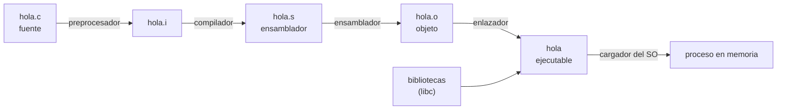
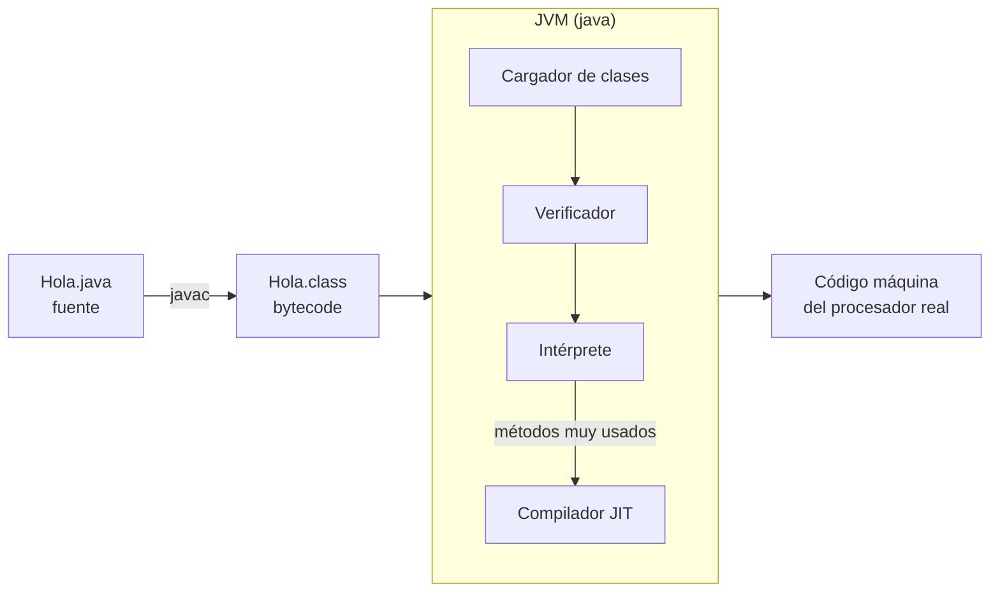

# 3. Del código fuente al ejecutable

## Tres tipos de código

- **Código fuente**: el texto escrito por el programador en un lenguaje de programación (`Hola.c`, `Hola.java`).
- **Código objeto**: el resultado de compilar un fichero fuente. Está en código máquina (o en código intermedio), pero aún no se puede ejecutar porque le faltan referencias a bibliotecas y a otros módulos (`hola.o`).
- **Código ejecutable**: el resultado de **enlazar** (*linking*) todos los ficheros objeto con las bibliotecas necesarias. El sistema operativo ya puede cargarlo y ejecutarlo (`hola` en Linux, `hola.exe` en Windows).

## Proceso en un lenguaje compilado (C)



```bash
gcc -c hola.c -o hola.o   # compilar: genera el objeto
gcc hola.o -o hola        # enlazar: genera el ejecutable
./hola                    # ejecutar
```

### Fases del compilador

| Fase | Qué hace | Error típico |
|------|----------|--------------|
| **Análisis léxico** | Divide el texto en *tokens* (identificadores, literales, operadores) | `int 1abc;` (identificador no válido) |
| **Análisis sintáctico** | Comprueba que los *tokens* siguen la gramática y construye el árbol sintáctico | Falta `;` o un paréntesis sin cerrar |
| **Análisis semántico** | Comprueba tipos, declaraciones y ámbitos | `int x = "hola";` |
| **Generación de código intermedio** | Representación independiente de la máquina | — |
| **Optimización** | Mejora el código sin cambiar su resultado | `a = 2 * 3 - 1` pasa a ser `a = 5` |
| **Generación de código** | Código máquina para un procesador concreto | — |

## Proceso en Java: compilación + máquina virtual

Java no genera código máquina de un procesador concreto, sino **bytecode**: un código intermedio que ejecuta la **Máquina Virtual de Java (JVM)**. Por eso un mismo `.class` funciona en cualquier sistema que tenga una JVM («escríbelo una vez, ejecútalo en cualquier lugar»).



```bash
javac Hola.java      # compila: genera Hola.class
java Hola            # la JVM carga y ejecuta el bytecode
javap -c Hola        # muestra el bytecode (desensamblado)
java Hola.java       # desde Java 11: compila en memoria y ejecuta un único fichero
```

Ejemplo de *bytecode* generado por `javap -c` para `System.out.println("Hola")`:

```text
0: getstatic     #7    // Field java/lang/System.out:Ljava/io/PrintStream;
3: ldc           #13   // String Hola
5: invokevirtual #15   // Method java/io/PrintStream.println:(Ljava/lang/String;)V
8: return
```

### Características del código intermedio y de las máquinas virtuales

- **Portabilidad**: el mismo *bytecode* se ejecuta en Windows, Linux o macOS, y en x86 o ARM.
- **Seguridad**: la JVM verifica el *bytecode* antes de ejecutarlo y aísla el programa en un entorno controlado.
- **Rendimiento**: el compilador **JIT** (*Just-In-Time*) traduce a código nativo los métodos que más se usan mientras el programa se ejecuta. Por eso un programa Java gana velocidad después de unos segundos.
- **Gestión automática de memoria** mediante el recolector de basura.
- **Coste**: hace falta instalar la máquina virtual y el arranque es algo más lento que el de un ejecutable nativo.

El mismo modelo se usa en **.NET** (C# compila a CIL, que ejecuta el CLR), en **Python** (ficheros `.pyc` que ejecuta la máquina virtual de CPython) y en **WebAssembly** (*bytecode* portable que ejecutan los navegadores).

## Virtualización y contenedores

La idea de «una capa que abstrae la máquina real» aparece a varios niveles:

| Nivel | Qué virtualiza | Ejemplos |
|-------|----------------|----------|
| Máquina virtual de proceso | Un entorno de ejecución para un lenguaje | JVM, CLR, motor V8 de JavaScript |
| Contenedor | El sistema operativo (el núcleo se comparte) | Docker, Podman |
| Máquina virtual de sistema | El hardware completo | VirtualBox, VMware, KVM |

## Herramientas implicadas

| Herramienta | Función | Ejemplos |
|-------------|---------|----------|
| Editor | Escribir el código fuente | VS Code, editor del IDE |
| Compilador | Traducir el fuente a código objeto o *bytecode* | `gcc`, `javac`, `tsc` |
| Intérprete o máquina virtual | Ejecutar código interpretado o intermedio | `python`, `java`, `node` |
| Enlazador | Unir objetos y bibliotecas | `ld` |
| Depurador | Ejecutar paso a paso e inspeccionar | `gdb`, el depurador del IDE |
| Gestor de construcción | Automatizar compilación, pruebas y empaquetado | Maven, Gradle, `make`, `npm` |
| Empaquetador | Generar el artefacto distribuible | `jar`, `jpackage` |

En la [UP2](../up2/index.md) verás cómo el IDE integra todas estas herramientas.
