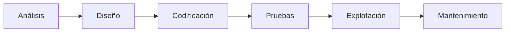
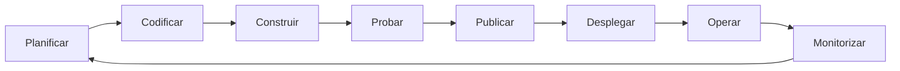

# 4. Fases y ciclos de vida

## Fases del desarrollo

Sea cual sea la metodología, en todo proyecto de software aparecen estas actividades. Su orden y su repetición dependen del **ciclo de vida** que se elija.

| Fase | Pregunta que responde | Resultados (artefactos) | Roles principales |
|------|-----------------------|-------------------------|-------------------|
| **Planificación** | ¿Es viable? ¿Cuánto cuesta y cuánto tarda? | Estudio de viabilidad, estimación, plan de proyecto | Jefe de proyecto |
| **Análisis** | ¿Qué debe hacer el sistema? | Especificación de requisitos (ERS), casos de uso, historias de usuario, prototipos | Analista, cliente |
| **Diseño** | ¿Cómo se va a construir? | Arquitectura, diagramas de clases y de interacción, modelo de datos, diseño de interfaz | Arquitecto, diseñador |
| **Codificación** | Construirlo | Código fuente, pruebas unitarias, comentarios y documentación técnica | Programador |
| **Pruebas** | ¿Funciona y hace lo que se pidió? | Plan de pruebas, casos de prueba, informes de incidencias | Equipo de calidad (QA) |
| **Documentación** | ¿Cómo se instala, usa y mantiene? | Manual de usuario, manual técnico y de instalación | Todo el equipo |
| **Explotación (despliegue)** | Ponerlo en producción | Instalación, migración de datos, pruebas de aceptación, formación | Administrador de sistemas, DevOps |
| **Mantenimiento** | Mantenerlo útil | Versiones corregidas y mejoradas | Equipo de mantenimiento |

### Tipos de mantenimiento

- **Correctivo**: corrige errores que no se detectaron en las pruebas.
- **Adaptativo**: adapta el software a cambios del entorno (nuevo sistema operativo, nueva versión de una biblioteca, cambio legal).
- **Perfectivo (evolutivo)**: añade o mejora funcionalidades a petición de los usuarios.
- **Preventivo**: mejora la estructura interna para facilitar cambios futuros (refactorización, actualización de dependencias).

El mantenimiento adaptativo y el perfectivo vuelven a recorrer las fases para obtener una nueva versión.

## Modelos de ciclo de vida

### Cascada

Las fases se suceden una tras otra y solo se pasa a la siguiente cuando termina la anterior.

- **Ventajas**: es sencillo de planificar y controlar, y genera mucha documentación.
- **Inconvenientes**: el cliente no ve nada hasta el final y los errores de análisis se descubren tarde, cuando corregirlos es caro.
- **Cuándo usarlo**: requisitos muy estables y bien conocidos, o proyectos con fuertes exigencias normativas.

### Modelo en V

Es una variante de la cascada que relaciona cada fase de desarrollo con su nivel de prueba: requisitos con pruebas de aceptación, diseño con pruebas de integración y codificación con pruebas unitarias. Se retoma en la [UP4](../up4/01-fundamentos.md).

### Iterativo e incremental (evolutivo)

El sistema se construye en **iteraciones**. Cada una recorre todas las fases y entrega un **incremento** que funciona y añade valor.

- **Ventajas**: el cliente recibe partes útiles pronto, los requisitos pueden cambiar y los riesgos se detectan antes.
- **Inconvenientes**: es más difícil estimar el coste total y la arquitectura debe soportar el crecimiento.

### Espiral (Boehm)

Cada vuelta de la espiral tiene cuatro actividades: **determinar objetivos**, **analizar riesgos**, **desarrollar y probar**, y **planificar la siguiente vuelta**.

- **Ventajas**: gestiona de forma explícita el riesgo y es adecuado para proyectos grandes e innovadores.
- **Inconvenientes**: es complejo y exige experiencia en análisis de riesgos.

### Prototipado

Se construye rápidamente una versión simplificada para validar requisitos o la interfaz con el cliente. Puede ser **desechable** (se tira y se construye el sistema real) o **evolutivo** (el prototipo se va completando hasta convertirse en el producto).

## De los modelos clásicos a la agilidad y DevOps

Los modelos iterativos son la base de las **metodologías ágiles** (apartado siguiente). En la actualidad, además, el ciclo de vida no termina en una entrega: con **DevOps**, desarrollo y operaciones forman un bucle continuo en el que se integra, prueba y despliega varias veces al día.

Las herramientas de este módulo cubren buena parte de ese bucle: Git para codificar en equipo (UP3), pruebas automáticas (UP4) e integración continua (UP5).

## Roles en un proyecto

- **Jefe de proyecto**: planifica, coordina el equipo y los plazos, y es el interlocutor con el cliente.
- **Analista**: obtiene y documenta los requisitos.
- **Arquitecto de software**: toma las decisiones técnicas de alto nivel (tecnologías, estructura, integración).
- **Diseñador** (de software y de UX/UI): define cómo se organiza la solución y cómo interactúa el usuario con ella.
- **Programador o desarrollador**: escribe y prueba el código.
- **Tester o QA**: diseña y ejecuta las pruebas e informa de las incidencias.
- **DevOps / administrador de sistemas**: automatiza la integración y el despliegue y mantiene la infraestructura.

En los equipos ágiles estos roles se agrupan de otra manera: lo verás en el apartado siguiente.
