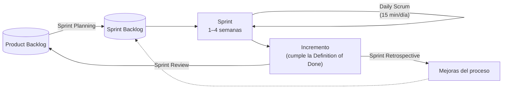

# 5. Metodologías ágiles

## El Manifiesto Ágil (2001)

Diecisiete profesionales firmaron un manifiesto con cuatro valores. Valoran más lo que está a la izquierda, sin despreciar lo de la derecha:

| Se valora más… | …que |
|----------------|------|
| **Individuos e interacciones** | procesos y herramientas |
| **Software funcionando** | documentación exhaustiva |
| **Colaboración con el cliente** | negociación contractual |
| **Respuesta ante el cambio** | seguir un plan |

El manifiesto se completa con **doce principios**. Entre ellos: entregar software que funcione con frecuencia (de semanas a pocos meses), aceptar cambios en los requisitos incluso al final, mantener un ritmo sostenible, buscar la excelencia técnica y la simplicidad, y reflexionar con regularidad para mejorar.

## Scrum

Scrum es un **marco de trabajo** ligero para desarrollar productos complejos en ciclos cortos llamados *sprints*.

### Roles (*accountabilities*)

- **Product Owner**: maximiza el valor del producto. Gestiona y ordena el *Product Backlog* y es la voz del cliente.
- **Scrum Master**: ayuda al equipo a aplicar Scrum, elimina impedimentos y facilita los eventos.
- **Developers**: el equipo multidisciplinar que construye el incremento. Se autoorganiza.

### Eventos

| Evento | Duración máxima (*sprint* de 1 mes) | Propósito |
|--------|:-----------------------------------:|-----------|
| *Sprint* | 1 mes | Contenedor de todos los demás eventos |
| *Sprint Planning* | 8 h | Decidir qué se hará y cómo, y fijar el objetivo del *sprint* |
| *Daily Scrum* | 15 min | Revisar el avance hacia el objetivo y adaptar el plan |
| *Sprint Review* | 4 h | Mostrar el incremento a los interesados y actualizar el *backlog* |
| *Sprint Retrospective* | 3 h | Mejorar la forma de trabajar del equipo |

### Artefactos

- **Product Backlog**: lista ordenada de todo lo que se sabe que necesita el producto, normalmente redactado como **historias de usuario**.
- **Sprint Backlog**: los elementos elegidos para el *sprint* y el plan para completarlos.
- **Incremento**: el resultado utilizable del *sprint*. Debe cumplir la **Definition of Done** (DoD), el acuerdo del equipo sobre cuándo algo está «terminado».

### Historias de usuario y estimación

Una historia de usuario describe una necesidad desde el punto de vista de quien la tiene:

> **Como** profesor, **quiero** importar la lista de alumnos desde una hoja de cálculo **para** no tener que teclearla a mano.
>
> *Criterios de aceptación:* acepta ficheros `.xlsx` y `.csv`; muestra los errores de formato por fila; no duplica alumnos ya existentes.

Una buena historia cumple **INVEST**: Independiente, Negociable, Valiosa, Estimable, pequeña (*Small*) y comprobable (*Testable*). El esfuerzo se estima en **puntos de historia**, a menudo con *Planning Poker* (cartas con la serie de Fibonacci: 1, 2, 3, 5, 8, 13…). La **velocidad** del equipo (puntos completados por *sprint*) sirve para prever las siguientes entregas.

## Kanban

Kanban es un método para **visualizar y mejorar el flujo de trabajo**:

1. **Visualizar** el trabajo en un tablero con columnas (*Por hacer → En curso → En revisión → Hecho*).
2. **Limitar el trabajo en curso** (WIP): no se empieza una tarea nueva hasta que hay hueco en la columna.
3. **Gestionar el flujo**: medir el tiempo de ciclo y eliminar los cuellos de botella.
4. **Explicitar las políticas**: qué significa que algo pase a la columna siguiente.
5. **Mejorar de forma continua.**

Kanban no prescribe roles ni iteraciones. Es habitual combinarlo con Scrum (Scrumban) o usarlo en equipos de mantenimiento y soporte, donde el trabajo llega de forma continua.

## Programación extrema (XP) y prácticas técnicas

XP aporta las **prácticas de ingeniería** que hacen posible la agilidad, muchas de las cuales se trabajan en este módulo:

| Práctica | En el módulo |
|----------|--------------|
| Desarrollo guiado por pruebas (TDD) y pruebas automáticas | [UP4](../up4/index.md) |
| Refactorización continua | [UP5](../up5/index.md) |
| Integración continua | [UP5](../up5/04-integracion-continua.md) |
| Propiedad colectiva del código y estándares de codificación | [UP3](../up3/index.md) y [UP5](../up5/02-analizadores.md) |
| Programación en parejas | Tareas colaborativas de la UP3 |
| Entregas pequeñas y frecuentes | Todo el curso |

## ¿Cuándo usar un enfoque ágil?

| Escenario | Enfoque recomendable |
|-----------|----------------------|
| Requisitos inciertos o que cambian a menudo; producto nuevo | Ágil (Scrum) |
| Trabajo continuo e imprevisible: soporte, mantenimiento, incidencias | Kanban |
| Requisitos estables, contrato cerrado y normativa estricta (sanidad, aviación) | Predictivo (cascada o modelo en V), o un enfoque híbrido |
| Proyecto grande, con varios equipos | Marcos de escalado (LeSS, SAFe, Nexus) |
| Equipo pequeño que necesita entregar pronto y con calidad técnica | Scrum + prácticas XP |

La agilidad **no** significa «sin planificación» ni «sin documentación»: se planifica y se documenta lo necesario, en el momento en que aporta valor.

## Herramientas de apoyo

- Tableros: GitHub Projects, Jira, Trello, Taiga (libre).
- Comunicación: Slack, Microsoft Teams, Discord.
- Integración y despliegue: GitHub Actions, GitLab CI (UP5).

En la tarea [T1.3](tareas.md#t13) organizarás un proyecto con un tablero de GitHub Projects.
