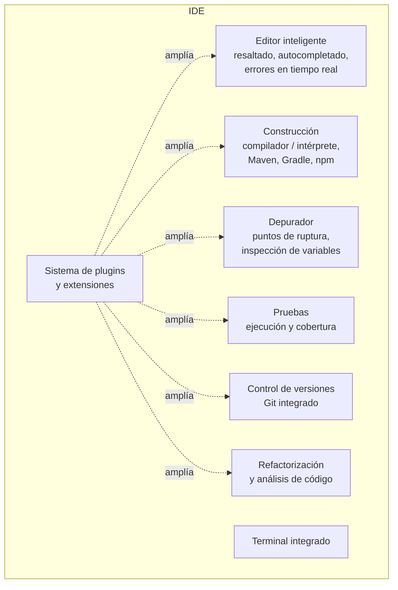

# 1. Qué es un IDE

Un **entorno de desarrollo integrado** (IDE, *Integrated Development Environment*) reúne en una sola aplicación las herramientas que se usan para escribir, construir, probar y depurar software. Su objetivo es la **productividad**: menos cambios de herramienta, más ayuda contextual y más automatización.

## Componentes

## Funciones principales

- **Edición asistida**: resaltado de sintaxis, autocompletado según el contexto, plegado de código, formateo automático y navegación (ir a la definición, buscar usos).
- **Detección de errores en tiempo real** y sugerencias de corrección (*quick fixes*).
- **Construcción** de proyectos complejos en un solo paso, gestión de dependencias y separación entre código fuente y compilado.
- **Ejecución y depuración**: configuraciones de ejecución, puntos de ruptura, ejecución paso a paso e inspección y modificación de variables (UP4).
- **Pruebas**: ejecución de pruebas unitarias y medición de la cobertura (UP4).
- **Refactorización** segura: renombrar, extraer método, mover… (UP5).
- **Control de versiones** integrado (UP3).
- **Generación de documentación** (Javadoc) y de diagramas (UP5 y UP6).
- **Asistentes de IA**: completado de bloques de código, explicaciones y generación de pruebas (GitHub Copilot, JetBrains AI Assistant, entre otros). Son útiles, pero sus propuestas deben revisarse como el código de cualquier otra persona.

## IDE o editor de código

| | Editor de código (VS Code, Sublime, Vim) | IDE completo (IntelliJ IDEA, Eclipse, Visual Studio) |
|---|---|---|
| Arranque y consumo | Ligero | Más pesado |
| Lenguajes | Muchos, mediante extensiones | Especializado (aunque admite varios) |
| Comprensión del código | La aportan las extensiones (protocolo LSP) | Análisis profundo integrado |
| Refactorización | Básica o mediante extensiones | Avanzada |
| Configuración | Ficheros JSON y extensiones | Asistentes y menús |

Gracias al **Language Server Protocol (LSP)**, hoy un editor ligero con las extensiones adecuadas se acerca mucho a un IDE. Por eso en este módulo usaremos los dos tipos.

## Panorama actual

| Entorno | Licencia | Lenguajes fuertes | Comentario |
|---------|----------|-------------------|------------|
| **IntelliJ IDEA** (JetBrains) | Propietario; gratuito en sus funciones básicas, con suscripción para las avanzadas | Java, Kotlin | Desde la versión 2025.3 tiene una única distribución: las funciones avanzadas se desbloquean con suscripción (gratuita para estudiantes con licencia educativa). |
| **Visual Studio Code** (Microsoft) | Gratuito; núcleo libre (MIT) | Todos, mediante extensiones | Es el editor más usado en desarrollo web. VSCodium es una compilación 100 % libre. |
| **Eclipse IDE** | Libre (EPL) | Java, C/C++ | Base de muchas herramientas empresariales. |
| **Apache NetBeans** | Libre (Apache 2.0) | Java, PHP | Integración sencilla con Maven y diseñador de interfaces Swing. |
| **Visual Studio** (Microsoft) | Propietario (la edición Community es gratuita con condiciones) | C#, C++, .NET | Solo para Windows. |
| **Xcode** (Apple) | Propietario, gratuito | Swift, Objective-C | Solo para macOS; desarrollo para iOS y macOS. |
| **Android Studio** (Google) | Gratuito, basado en IntelliJ | Kotlin, Java | Desarrollo Android. |

### Entornos en la nube

Permiten programar desde el navegador con un entorno ya preparado: **GitHub Codespaces** (VS Code en la nube con un contenedor configurable), **Google Cloud Shell Editor** o los entornos remotos de JetBrains. Su ventaja es que el entorno es idéntico para todo el equipo y no hay que instalar nada. Sus inconvenientes son que dependen de la conexión y que el uso gratuito está limitado.

## Libre o propietario: criterios de elección

- **Lenguaje y tipo de proyecto**: lo primero. No es lo mismo Android que web o .NET.
- **Licencia y coste**, sobre todo para uso comercial.
- **Ecosistema**: *plugins*, integración con herramientas de construcción, control de versiones y CI.
- **Rendimiento** en el equipo disponible.
- **Estándar del equipo o de la empresa**: un entorno común facilita compartir configuraciones.
