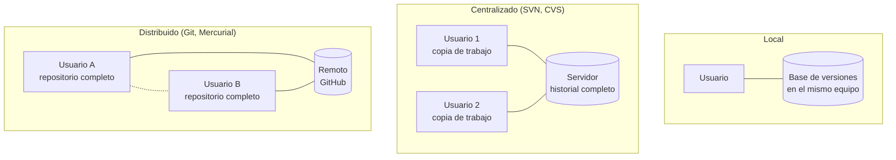

# 1. Sistemas de control de versiones

Un **sistema de control de versiones** (SCV o VCS, *Version Control System*) registra los cambios de un conjunto de ficheros a lo largo del tiempo, de modo que se puede:

- **recuperar** cualquier estado anterior;
- **saber quién cambió qué, cuándo y por qué**;
- **trabajar en paralelo** en distintas líneas de desarrollo (ramas) y combinarlas después;
- **colaborar** varias personas sobre el mismo código sin pisarse.

Aunque se usa sobre todo con código, sirve para cualquier fichero de texto: documentación, configuración o incluso este sitio web.

## Modelos

| | Centralizado | Distribuido |
|---|---|---|
| ¿Dónde está el historial? | Solo en el servidor | En cada copia (y normalmente también en un remoto común) |
| ¿Se puede trabajar sin conexión? | No (para confirmar cambios) | Sí: los *commits* son locales |
| Velocidad | Depende de la red | Casi todas las operaciones son locales e instantáneas |
| Si cae el servidor | No se puede trabajar y se arriesga el historial | Cualquier copia puede restaurarlo |
| Ramas | Costosas | Baratas y habituales |
| Inconvenientes | Punto único de fallo | Curva de aprendizaje mayor; identificadores poco legibles (*hashes*) |

## Herramientas

| Herramienta | Modelo | Licencia | Situación actual |
|-------------|--------|----------|------------------|
| **Git** | Distribuido | GPLv2 | Estándar de facto. Creado por Linus Torvalds en 2005 para el núcleo de Linux. |
| Mercurial | Distribuido | GPLv2 | Uso minoritario. |
| Subversion (SVN) | Centralizado | Apache 2.0 | Todavía presente en proyectos antiguos. |
| CVS | Centralizado | GPL | Obsoleto. |

Plataformas de alojamiento de repositorios Git: **GitHub**, **GitLab**, **Bitbucket**, **Codeberg** y **Gitea/Forgejo** (instalables en un servidor propio). Además de alojar el código, ofrecen gestión de incidencias, revisión de código, integración continua y publicación web.

## Terminología

| Término | Significado |
|---------|-------------|
| **Repositorio** | Almacén con todos los ficheros y su historial (en Git, la carpeta oculta `.git`). |
| **Copia de trabajo** (*working tree*) | Los ficheros que ves y editas. |
| **Área de preparación** (*staging area* o *index*) | Lo que entrará en el próximo *commit*. |
| **Commit** (confirmación) | Instantánea del proyecto con autor, fecha, mensaje y un identificador único (*hash*). |
| **HEAD** | Referencia a la posición actual (normalmente, el último *commit* de la rama activa). |
| **Rama** (*branch*) | Línea de desarrollo independiente. La principal suele llamarse `main`. |
| **Fusión** (*merge*) | Combinar los cambios de una rama en otra. |
| **Conflicto** | Dos ramas cambian las mismas líneas de forma distinta y Git necesita que una persona decida. |
| **Etiqueta** (*tag*) | Nombre fijo para un *commit* concreto, típicamente una versión (`v1.0.0`). |
| **Remoto** | Copia del repositorio en otro lugar (por ejemplo, `origin` en GitHub). |
| **Clonar** | Obtener una copia local completa de un repositorio remoto. |
| **Push / Pull / Fetch** | Enviar *commits* al remoto, traerlos y fusionarlos, o solo traerlos. |
| **Pull request** (*merge request* en GitLab) | Propuesta para fusionar una rama, con discusión y revisión. |
| **Fork** | Copia de un repositorio ajeno en tu cuenta, para proponer cambios sin tener permisos de escritura. |
