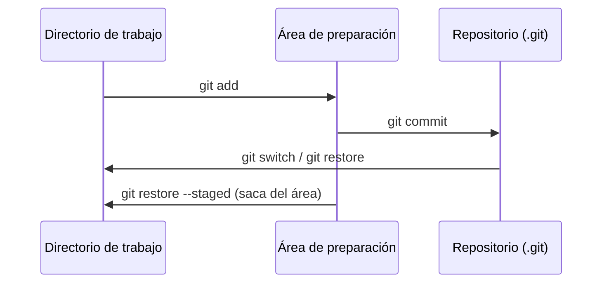

# 2. Git: primeros pasos

## Configuración inicial

```bash
git config --global user.name "Nombre Apellido"
git config --global user.email "tu-correo@ejemplo.com"
git config --global init.defaultBranch main
git config --global core.editor "code --wait"   # usar VS Code como editor
git config --list                               # comprobar
```

## Las tres áreas de Git



Cada fichero puede estar **sin seguimiento** (*untracked*), **modificado**, **preparado** (*staged*) o **confirmado** (*committed*).

## Primer repositorio

```bash
mkdir parking && cd parking
git init                          # crea .git
echo "# Parking" > README.md
git status                        # README.md aparece sin seguimiento
git add README.md                 # al área de preparación
git commit -m "Añade README inicial"
git log --oneline                 # historial resumido
```

## Comandos esenciales

| Comando | Para qué |
|---------|----------|
| `git status` | Estado de la copia de trabajo y del área de preparación |
| `git add <fich>` / `git add .` | Preparar cambios concretos o todos |
| `git commit -m "mensaje"` | Confirmar lo preparado |
| `git diff` / `git diff --staged` | Ver cambios no preparados / preparados |
| `git log --oneline --graph --all` | Historial en forma de grafo |
| `git show <commit>` | Detalle de un *commit* |
| `git restore <fich>` | Descartar cambios no preparados de un fichero |
| `git restore --staged <fich>` | Quitar un fichero del área de preparación |
| `git commit --amend` | Corregir el último *commit* (solo si **no** se ha publicado) |
| `git revert <commit>` | Crear un *commit* que deshace otro (seguro si ya se ha publicado) |
| `git reset --soft/--mixed/--hard <commit>` | Mover la rama a otro *commit* (¡cuidado con `--hard`!) |
| `git tag -a v1.0 -m "Versión 1.0"` | Etiquetar una versión |

!!! danger "Deshacer con cuidado"
    `git reset --hard` y `git push --force` pueden **borrar trabajo** de forma irreversible, también el de tus compañeros. Cuando los cambios ya se han compartido, usa `git revert`.

## Ignorar ficheros: `.gitignore`

No se versionan los ficheros generados (compilados, empaquetados), los de configuración personal del IDE ni los **secretos** (contraseñas, claves de API). Se listan en `.gitignore`:

```gitignore
# Compilados
/out/
/target/
*.class

# IDE
.idea/
.vscode/*
!.vscode/extensions.json

# Sistema operativo
.DS_Store
Thumbs.db
```

Tienes una plantilla completa en [gitignore-java.txt](../recursos/up3/gitignore-java.txt). En [github.com/github/gitignore](https://github.com/github/gitignore) hay plantillas para casi cualquier tecnología.

## Buenos mensajes de *commit*

Un historial legible es documentación del proyecto. Pautas:

- Un *commit* = **un cambio lógico** (no «todo lo de hoy»).
- Primera línea de **50–72 caracteres**, en imperativo: «Añade validación de plazas», «Corrige cálculo de la media».
- Si hace falta, una línea en blanco y después el **porqué** del cambio.

Muchos equipos siguen la convención **Conventional Commits**, que además permite generar *changelogs* automáticamente:

```text
feat: añade cálculo de la planta con más plazas libres
fix: valida que solo se introduzcan 0 o 1
docs: explica la ejecución en el README
refactor: extrae el método mostrarPlanta
test: añade pruebas de contarLibres
```

Mensajes como `cambios`, `funciona` o `final` **no** son aceptables en las entregas.
