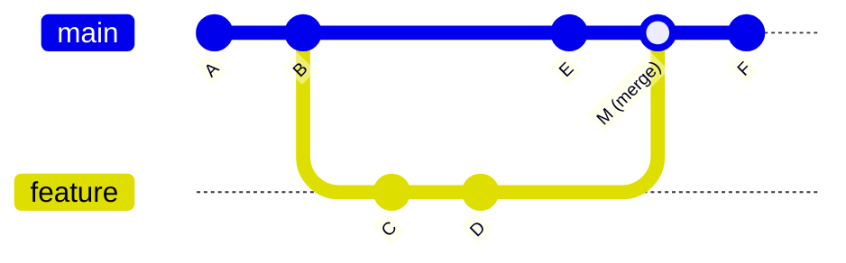
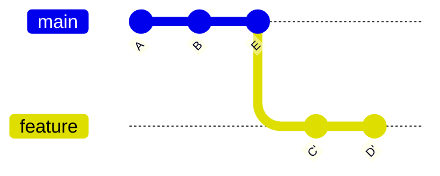

# 3. Ramas y fusiones

Una **rama** es simplemente un puntero móvil a un *commit*. Crearla es instantáneo, y por eso en Git se usan ramas para cualquier cambio: una funcionalidad, una corrección, un experimento.

## Crear y cambiar de rama

```bash
git branch                       # listar ramas (* = actual)
git switch -c feature/planta-libre   # crear y cambiar a la nueva rama
# ... editar, add, commit ...
git switch main                  # volver a main
git branch -d feature/planta-libre   # borrar la rama ya fusionada
```

!!! note "`switch` y `checkout`"
    `git switch` (cambiar de rama) y `git restore` (restaurar ficheros) sustituyen desde Git 2.23 a los usos de `git checkout`, que hacía las dos cosas. En documentación antigua verás `git checkout -b rama`.

## Tipos de fusión



- **Avance rápido** (*fast-forward*): si `main` no ha cambiado desde que se creó la rama, Git solo mueve el puntero de `main` hacia delante. No se crea ningún *commit* nuevo.
- **Fusión de tres vías** (*three-way merge*): si las dos ramas han avanzado (como en el diagrama), Git combina los cambios a partir del ancestro común y crea un **commit de fusión** (`M`).

```bash
git switch main
git merge feature/planta-libre          # fusiona en la rama actual
git merge --no-ff feature/planta-libre  # fuerza un commit de fusión aunque se pudiera avanzar rápido
```

## Conflictos

Si las dos ramas modifican **las mismas líneas** de un fichero, Git no sabe qué versión elegir y marca el conflicto:

```java
<<<<<<< HEAD
System.out.println("Bienvenido a Hundir la flota");
=======
System.out.println("¡Hundir la flota! Introduce fila y columna:");
>>>>>>> rama-alumnoB
```

Para resolverlo:

1. `git status` muestra los ficheros en conflicto (*both modified*).
2. Edita el fichero: deja el código correcto y **borra los marcadores** `<<<<<<<`, `=======` y `>>>>>>>`. Los IDE ofrecen una vista de tres paneles que facilita esta tarea.
3. Comprueba que el programa compila y funciona.
4. `git add Main.java` y `git commit` (Git propone un mensaje de fusión).

Para abandonar una fusión a medias: `git merge --abort`.

## Rebase (introducción)

`git rebase main` **reaplica** los *commits* de tu rama encima del último *commit* de `main`, de modo que el historial queda lineal, sin *commits* de fusión.



!!! warning "Regla de oro del rebase"
    No hagas *rebase* de *commits* que ya has compartido en un remoto, porque reescribe su historial. Úsalo solo para ordenar tu trabajo local antes de publicarlo.

## Otras herramientas útiles

| Comando | Uso |
|---------|-----|
| `git stash` / `git stash pop` | Guardar temporalmente cambios sin confirmar para cambiar de rama |
| `git cherry-pick <commit>` | Aplicar en la rama actual un *commit* concreto de otra rama |
| `git log main..feature` | *Commits* de `feature` que aún no están en `main` |
| `git diff main...feature` | Cambios de `feature` desde que se separó de `main` |
