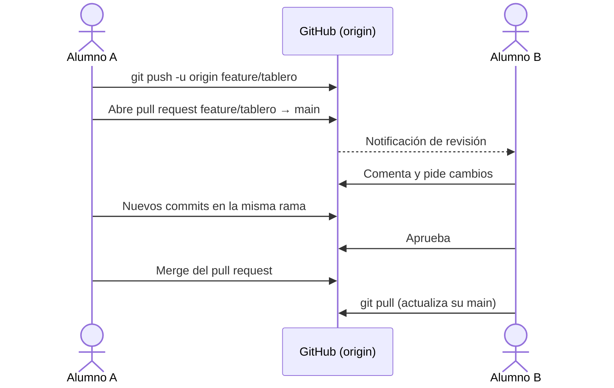
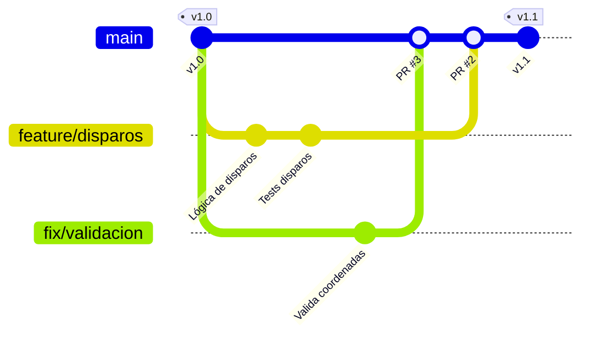

# 4. Repositorios remotos y colaboración

## Remotos

Un **remoto** es otra copia del repositorio, normalmente en una plataforma como GitHub. Por convención, el remoto principal se llama `origin`.

```bash
# Opción A: empezar desde GitHub
git clone https://github.com/usuario/parking-matrices-java.git

# Opción B: publicar un repositorio local existente
git remote add origin https://github.com/usuario/parking-matrices-java.git
git remote -v
git push -u origin main         # -u enlaza main local con origin/main
```

| Comando | Efecto |
|---------|--------|
| `git fetch` | Trae los *commits* nuevos del remoto **sin** tocar tus ramas (actualiza `origin/main`). |
| `git pull` | `fetch` + fusiona (o *rebase*) en la rama actual. |
| `git push` | Envía tus *commits* al remoto. Se rechaza si el remoto tiene *commits* que no tienes: haz antes `pull`. |
| `git push -u origin rama` | Publica una rama nueva. |
| `git branch -r` / `git branch -a` | Ramas remotas / todas las ramas. |

## Autenticación en GitHub

GitHub ya no admite la contraseña de la cuenta para operar con Git. Opciones:

- **GitHub CLI**: `gh auth login` configura la autenticación por HTTPS de forma guiada (la opción más sencilla).
- **Gestor de credenciales** del sistema (Git Credential Manager, incluido en Git para Windows) o del IDE: inicias sesión en el navegador una vez.
- **Token de acceso personal** (*fine-grained*) como contraseña por HTTPS.
- **Clave SSH**: `ssh-keygen -t ed25519 -C "tu-correo"` y añades la clave pública en *GitHub → Settings → SSH and GPG keys*. Después se clona con `git@github.com:usuario/repo.git`.

## Colaborar: *pull requests* y revisión de código



Un buen ***pull request*** (PR):

- resuelve **una sola cosa** y es pequeño (fácil de revisar);
- tiene un título claro y una descripción con **qué** cambia, **por qué** y **cómo probarlo**;
- enlaza la incidencia (*issue*) que resuelve (`Closes #12`);
- pasa las comprobaciones automáticas (en la UP5 añadiremos integración continua).

Al **revisar** un PR: comprueba que funciona, que se entiende y que sigue las convenciones del proyecto. Comenta el código, no a la persona, y propone en lugar de imponer.

### Otras herramientas de colaboración en GitHub

- ***Issues***: tareas, errores y propuestas, con etiquetas, responsables e hitos.
- **Projects**: tableros Kanban vinculados a las *issues* y los PR (UP1).
- **Protección de ramas**: impide hacer *push* directo a `main` y exige PR con revisión y comprobaciones superadas.
- **Fork + PR**: para contribuir a proyectos en los que no tienes permiso de escritura (el flujo habitual del software libre).

## Estrategias de ramificación

| Estrategia | Idea | Adecuada para |
|------------|------|---------------|
| **Centralizada** | Todos trabajan directamente en `main` | Personas solas o equipos muy pequeños (desaconsejada en equipo) |
| **Ramas de funcionalidad** | Una rama por funcionalidad, que se fusiona en `main` | Base de las estrategias siguientes |
| **GitHub Flow** | `main` siempre desplegable; rama corta + PR + revisión + *merge* + despliegue | Aplicaciones web con despliegue continuo. **La usaremos en el módulo.** |
| **Git Flow** | Ramas permanentes `main` y `develop`, más ramas `feature/*`, `release/*` y `hotfix/*` | Productos con versiones planificadas y varias versiones en mantenimiento |
| ***Trunk-based development*** | Integración en la rama principal varias veces al día; ramas de horas, no de días; funcionalidades ocultas con *feature flags* | Equipos maduros con muchas pruebas automáticas e integración continua |



*GitHub Flow: las ramas nacen de `main`, viven poco tiempo y vuelven a `main` mediante un PR revisado.*

### Convenciones de nombres de rama

`feature/descripcion-corta`, `fix/descripcion`, `docs/...`, `refactor/...`. En las tareas en parejas también se admite `nombre/descripcion`.
