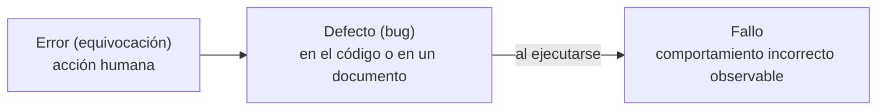
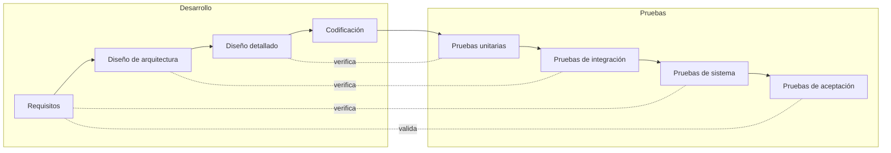

# 1. Fundamentos de las pruebas

## Para qué se prueba

Las pruebas tienen como objetivo **encontrar defectos** antes de que lo hagan los usuarios y **aportar confianza** de que el software se comporta como se espera. Dos ideas clave:

- **Verificación**: ¿estamos construyendo el producto **correctamente**? (¿cumple la especificación?)
- **Validación**: ¿estamos construyendo el producto **correcto**? (¿es lo que el usuario necesita?)

## Error, defecto y fallo

En JUnit verás una distinción práctica parecida: un *test* **falla** (*failure*) cuando una aserción no se cumple (el resultado es incorrecto) y produce un **error** cuando se lanza una excepción inesperada.

## Siete principios (ISTQB)

1. Las pruebas muestran la presencia de defectos, **no su ausencia**.
2. Las pruebas exhaustivas son imposibles: hay que **priorizar**.
3. **Probar pronto** ahorra tiempo y dinero.
4. Los defectos tienden a **agruparse** en pocos módulos.
5. **Paradoja del pesticida**: repetir siempre las mismas pruebas deja de encontrar defectos nuevos.
6. Las pruebas **dependen del contexto** (no se prueba igual una web que un marcapasos).
7. La **falacia de la ausencia de errores**: un sistema sin fallos que no sirve al usuario no tiene valor.

## Niveles de prueba: el modelo en V

| Nivel | Qué se prueba | Quién | Ejemplo |
|-------|---------------|-------|---------|
| **Unitarias** | Una unidad aislada (método, clase) | Desarrollador | `calcularMedia(4, 6, 8)` devuelve `6` |
| **Integración** | La interacción entre componentes | Desarrollador o QA | El servicio guarda correctamente en la base de datos |
| **Sistema** | El sistema completo frente a los requisitos | QA | Un usuario puede reservar una mesa de principio a fin |
| **Aceptación** | Que el sistema satisface al cliente | Cliente o usuarios | Pruebas alfa (en las instalaciones del desarrollador) y beta (en el entorno real) |

### La pirámide de pruebas

Muchas pruebas **unitarias** (rápidas y baratas), menos de **integración** y pocas pruebas **de extremo a extremo** a través de la interfaz (lentas y frágiles).

## Tipos de prueba

| Tipo | Objetivo | Técnica habitual |
|------|----------|------------------|
| **Funcionales** | Qué hace el sistema: comprobar entradas y salidas según la especificación | Caja negra |
| **No funcionales** | Cómo lo hace: rendimiento, carga, estrés, seguridad, usabilidad, accesibilidad | Herramientas específicas (JMeter, Lighthouse…) |
| **Estructurales** | Recorrer la lógica interna del código | Caja blanca, cobertura |
| **Regresión** | Que un cambio no ha estropeado lo que ya funcionaba | Volver a ejecutar las pruebas automáticas |
| **Humo** (*smoke*) | Comprobación rápida de que lo esencial arranca y funciona | Pequeño subconjunto de pruebas |

!!! tip "Regresión y automatización"
    Las pruebas de regresión solo son viables si están **automatizadas**. Esa es la razón principal para escribir pruebas con JUnit y ejecutarlas en cada cambio, ya sea en local o en integración continua (UP5).

## Plan de pruebas

Un **plan de pruebas** (por ejemplo, según la norma ISO/IEC/IEEE 29119-3, sucesora del IEEE 829) recoge:

1. Introducción y **alcance**: qué se prueba y qué **no** se prueba.
2. **Elementos** (módulos, clases) y **características** que se van a probar.
3. **Enfoque**: niveles, técnicas y herramientas.
4. **Criterios** de entrada, de salida y de aceptación o rechazo.
5. **Entorno**: hardware, software y datos de prueba.
6. **Responsables y calendario**.
7. **Riesgos** y contingencias.
8. **Entregables**: casos de prueba, informes de ejecución, informes de incidencias.

En equipos ágiles el plan es más ligero y se apoya en la *Definition of Done* («toda historia tiene pruebas automáticas que pasan en la integración continua»).

## Procedimiento y caso de prueba

- Un **caso de prueba** define *qué* se prueba: identificador, precondiciones, datos de entrada, pasos, **resultado esperado** y resultado obtenido.
- Un **procedimiento de prueba** define *cómo* se ejecuta un conjunto de casos: orden, preparación del entorno y limpieza posterior.

| ID | Descripción | Entrada | Resultado esperado | Obtenido | ¿Pasa? |
|----|-------------|---------|--------------------|----------|:------:|
| CP-01 | Media con notas válidas | 4, 6, 8 | 6,0 | 6,0 | ✔ |
| CP-02 | Nota fuera de rango | 4, 11, 8 | Error «nota no válida» | 7,67 | ✘ |
