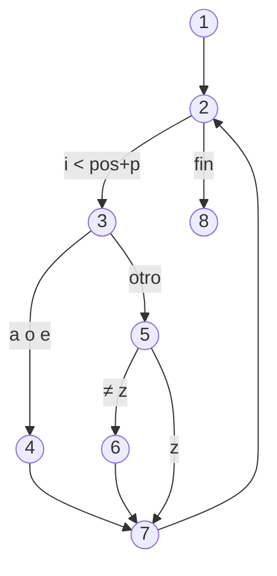

# 2. Diseño de casos de prueba

Como no se puede probar todo, hay que **elegir bien** los casos. Para eso existen técnicas sistemáticas.

## Caja negra (funcionales)

Se diseñan a partir de la **especificación**, sin mirar el código.

### Clases de equivalencia

Se divide el dominio de cada entrada en **clases** cuyos valores se comportan igual: basta con probar un representante de cada clase.

**Ejemplo.** `calificar(double nota)` devuelve `"Suspenso"` si la nota está en [0, 5), `"Aprobado"` si está en [5, 7), `"Notable"` en [7, 9), `"Sobresaliente"` en [9, 10] y lanza `IllegalArgumentException` si la nota está fuera de [0, 10].

| Clase | Rango | Tipo | Representante |
|-------|-------|:----:|:-------------:|
| CE1 | nota < 0 | No válida | −3 |
| CE2 | 0 ≤ nota < 5 | Válida | 2,5 |
| CE3 | 5 ≤ nota < 7 | Válida | 6 |
| CE4 | 7 ≤ nota < 9 | Válida | 8 |
| CE5 | 9 ≤ nota ≤ 10 | Válida | 9,5 |
| CE6 | nota > 10 | No válida | 12 |

Reglas: un caso puede cubrir **varias clases válidas**, pero **cada clase no válida** necesita su propio caso (si no, un error podría ocultar a otro).

### Análisis de valores límite

Los errores se concentran en los **bordes** (`<` en lugar de `<=`). Para cada límite se prueba el valor **exacto**, el inmediatamente **inferior** y el inmediatamente **superior**:

| Límite | Valores de prueba |
|:------:|-------------------|
| 0 | −0,01 · 0 · 0,01 |
| 5 | 4,99 · 5 · 5,01 |
| 7 | 6,99 · 7 · 7,01 |
| 9 | 8,99 · 9 · 9,01 |
| 10 | 9,99 · 10 · 10,01 |

Para cadenas y colecciones: vacía, un elemento, el máximo permitido y uno más del máximo. Para objetos: `null`.

### Tablas de decisión

Cuando el resultado depende de **combinaciones de condiciones**, se tabulan todas:

| Condición / Acción | R1 | R2 | R3 | R4 |
|--------------------|:--:|:--:|:--:|:--:|
| ¿Es socio? | S | S | N | N |
| ¿Compra > 50 €? | S | N | S | N |
| **Descuento** | 15 % | 5 % | 5 % | 0 % |

Cada columna es un caso de prueba.

## Caja blanca (estructurales)

Se diseñan **mirando el código** para recorrer su lógica.

### Criterios de cobertura

| Cobertura | Exige que… | Fuerza |
|-----------|------------|:------:|
| **De sentencias** | cada instrucción se ejecute al menos una vez | Baja |
| **De decisiones (ramas)** | cada decisión tome los valores verdadero y falso | Media |
| **De condiciones** | cada condición simple de una decisión compuesta tome ambos valores | Media |
| **Decisión/condición** | se cumplan a la vez las dos anteriores | Alta |
| **De caminos** | se recorran los caminos independientes del grafo | Alta |

### Grafo de flujo y complejidad ciclomática

Partimos del método de la práctica de JUnit del curso anterior, ya modificado para sustituir `a` y `e` por `*` y eliminar las `z`:

```java linenums="1"
public static String obtenerSubcadena(String cadena, int pos, int p) {
    char[] caracteres = cadena.toCharArray();         // 1
    String subcadena = "";                            // 1
    for (int i = pos; i < pos + p; i++) {             // 2
        char c = caracteres[i];                       // 3
        if (c == 'a' || c == 'e') {                   // 3
            subcadena += '*';                         // 4
        } else if (c != 'z') {                        // 5
            subcadena += c;                           // 6
        }
    }                                                 // 7 (i++)
    return subcadena;                                 // 8
}
```



La **complejidad ciclomática** V(G) indica el número de **caminos independientes**, es decir, el número mínimo de casos para la cobertura de caminos. Se calcula de tres formas equivalentes:

- V(G) = aristas − nodos + 2 = 10 − 8 + 2 = **4**
- V(G) = nodos predicado + 1 = 3 (nodos 2, 3 y 5) + 1 = **4**
- V(G) = número de regiones del grafo = **4**

!!! note "Condiciones compuestas"
    Si se desdobla `c == 'a' || c == 'e'` en dos nodos (uno por condición simple), V(G) sube a 5. Para la cobertura de condiciones hay que probar por separado la `a` y la `e`.

Caminos independientes y casos de prueba:

| Camino | Recorrido | Entrada (`cadena`, `pos`, `p`) | Esperado |
|--------|-----------|--------------------------------|----------|
| C1 | 1-2-8 (no entra en el bucle) | `"hola"`, 0, 0 | `""` |
| C2 | 1-2-3-4-7-2-8 | `"a"`, 0, 1 | `"*"` |
| C3 | 1-2-3-5-6-7-2-8 | `"b"`, 0, 1 | `"b"` |
| C4 | 1-2-3-5-7-2-8 | `"z"`, 0, 1 | `""` |

Y **no olvides** los casos que el código no contempla: `pos` negativo o `pos + p` mayor que la longitud (lanzan `ArrayIndexOutOfBoundsException`), o `cadena` igual a `null`. Esto lleva a decidir si el método debe validar sus parámetros: es una decisión de diseño que se documenta.

## Cobertura con herramientas

IntelliJ IDEA (*Run with Coverage*), VS Code (*Run Tests with Coverage*) y **JaCoCo** con Maven miden la cobertura de líneas y de ramas. Una cobertura alta **no garantiza** que las pruebas sean buenas (puede haber pruebas sin aserciones), pero una cobertura baja **sí** indica que hay código sin probar.
