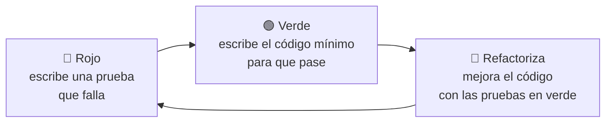

# 4. Pruebas unitarias con JUnit

**JUnit** es el *framework* estándar de pruebas unitarias en Java. La versión actual es **JUnit 6** (septiembre de 2025), que requiere Java 17 o superior y unifica las versiones de sus componentes (Platform, Jupiter y Vintage). Si conoces JUnit 5, la forma de escribir las pruebas es la misma: las anotaciones están en `org.junit.jupiter.api`.

## Características de una buena prueba unitaria (FIRST)

- ***Fast***: rápida (milisegundos).
- ***Independent***: no depende de otras pruebas ni del orden en que se ejecutan.
- ***Repeatable***: da el mismo resultado siempre y en cualquier máquina.
- ***Self-validating***: comprueba el resultado por sí misma con aserciones (sin que nadie tenga que mirar la consola).
- ***Timely***: se escribe a la vez que el código (o antes, en TDD).

## Maven en lo justo

**Maven** gestiona la estructura del proyecto, las **dependencias** (descarga JUnit por ti) y el **ciclo de construcción** (`compile` → `test` → `package` → …).

```text
calculadora/
├── pom.xml
└── src/
    ├── main/java/es/daw/ed/Calculadora.java
    └── test/java/es/daw/ed/CalculadoraTest.java
```

```xml title="pom.xml (fragmento esencial)"
<properties>
    <maven.compiler.release>25</maven.compiler.release>
    <project.build.sourceEncoding>UTF-8</project.build.sourceEncoding>
</properties>

<dependencyManagement>
    <dependencies>
        <dependency>
            <groupId>org.junit</groupId>
            <artifactId>junit-bom</artifactId>
            <version>6.0.2</version>
            <type>pom</type>
            <scope>import</scope>
        </dependency>
    </dependencies>
</dependencyManagement>

<dependencies>
    <dependency>
        <groupId>org.junit.jupiter</groupId>
        <artifactId>junit-jupiter</artifactId>
        <scope>test</scope>
    </dependency>
</dependencies>

<build>
    <plugins>
        <plugin>
            <groupId>org.apache.maven.plugins</groupId>
            <artifactId>maven-surefire-plugin</artifactId>
            <version>3.5.2</version>
        </plugin>
    </plugins>
</build>
```

Tienes el [pom.xml completo de ejemplo](../recursos/up4/pom.xml), con JUnit, Mockito y JaCoCo. Las versiones cambian a menudo: comprueba la última en [Maven Central](https://central.sonatype.com/).

```bash
mvn test          # compila y ejecuta las pruebas
mvn package       # además, empaqueta el JAR (solo si las pruebas pasan)
mvn verify        # incluye el informe de cobertura de JaCoCo (target/site/jacoco)
```

IntelliJ IDEA y VS Code detectan el `pom.xml` y permiten ejecutar las pruebas con un clic (icono ▶ junto a cada clase o método).

## Anatomía de una prueba

```java title="CalculadoraTest.java"
package es.daw.ed;

import org.junit.jupiter.api.*;
import static org.junit.jupiter.api.Assertions.*;

class CalculadoraTest {

    private Calculadora calc;

    @BeforeEach
    void setUp() {                 // se ejecuta antes de CADA prueba
        calc = new Calculadora();
    }

    @Test
    @DisplayName("Sumar dos positivos devuelve su suma")
    void sumarPositivos() {
        // Arrange (preparar)
        int a = 2, b = 3;
        // Act (actuar)
        int resultado = calc.sumar(a, b);
        // Assert (comprobar)
        assertEquals(5, resultado);
    }

    @Test
    void dividirEntreCeroLanzaExcepcion() {
        ArithmeticException ex = assertThrows(ArithmeticException.class,
                () -> calc.dividir(10, 0));
        assertEquals("No se puede dividir entre cero", ex.getMessage());
    }
}
```

### Anotaciones principales

| Anotación | Uso |
|-----------|-----|
| `@Test` | Método de prueba |
| `@DisplayName("…")` | Nombre legible en el informe |
| `@BeforeEach` / `@AfterEach` | Antes o después de **cada** prueba |
| `@BeforeAll` / `@AfterAll` | Una vez antes o después de **todas** (método `static`) |
| `@ParameterizedTest` + `@ValueSource`, `@CsvSource`, `@MethodSource` | La misma prueba con varios datos |
| `@Nested` | Agrupar pruebas relacionadas en una clase interna |
| `@Disabled("motivo")` | Desactivar temporalmente una prueba |
| `@Tag("lenta")` | Etiquetar pruebas para filtrarlas |
| `@Timeout(1)` | Hacer fallar la prueba si tarda más de 1 segundo |

### Aserciones principales

| Aserción | Comprueba |
|----------|-----------|
| `assertEquals(esperado, real)` | Igualdad (con `delta` para `double`: `assertEquals(0.3, x, 1e-9)`) |
| `assertNotEquals`, `assertSame`, `assertNull`, `assertNotNull` | Desigualdad, misma referencia, nulidad |
| `assertTrue(cond)` / `assertFalse(cond)` | Condición booleana |
| `assertArrayEquals(esp, real)` | Contenido de *arrays* |
| `assertThrows(Tipo.class, () -> …)` | Que se lanza la excepción indicada |
| `assertAll(() -> …, () -> …)` | Varias aserciones, informando de todos los fallos |
| `assertTimeout(Duration, () -> …)` | Que termina a tiempo |

## Pruebas parametrizadas: valores límite en pocas líneas

```java
@ParameterizedTest(name = "nota {0} → {1}")
@CsvSource({
    "0,    Suspenso",
    "4.99, Suspenso",
    "5,    Aprobado",
    "6.99, Aprobado",
    "7,    Notable",
    "9,    Sobresaliente",
    "10,   Sobresaliente"
})
void calificarValoresLimite(double nota, String esperado) {
    assertEquals(esperado, Notas.calificar(nota));
}

@ParameterizedTest
@ValueSource(doubles = {-0.01, 10.01, -3, 12})
void notaFueraDeRangoLanzaExcepcion(double nota) {
    assertThrows(IllegalArgumentException.class, () -> Notas.calificar(nota));
}
```

## Desarrollo guiado por pruebas (TDD)

**TDD** invierte el orden habitual: primero la prueba y después el código.



Se consigue un código con alta cobertura por diseño, interfaces pensadas desde el punto de vista de quien las usa y una red de seguridad para refactorizar (UP5).
