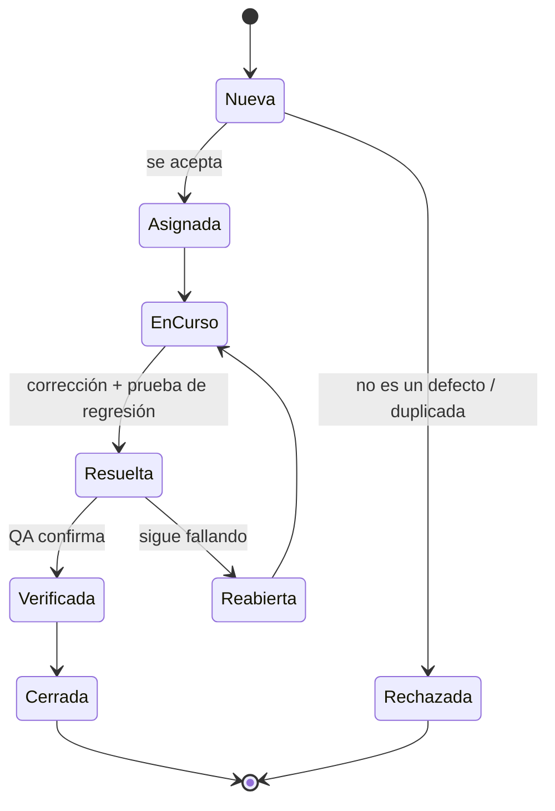

# 6. Documentar incidencias

Encontrar un defecto solo sirve si alguien puede **reproducirlo y corregirlo**. Un buen informe de incidencia ahorra horas a quien lo recibe.

## Contenido de un informe

| Campo | Contenido |
|-------|-----------|
| **ID y título** | Breve y específico: «La media se calcula con notas superiores a 10» (no «falla la media») |
| **Entorno** | Versión de la aplicación o *commit*, sistema operativo, versión de Java |
| **Precondiciones** | Estado necesario antes de empezar |
| **Pasos para reproducir** | Numerados, mínimos y exactos |
| **Resultado esperado** | Lo que debería ocurrir según la especificación |
| **Resultado obtenido** | Lo que ocurre (mensaje de error, traza, captura) |
| **Severidad** | Impacto técnico: crítica, alta, media o baja |
| **Prioridad** | Urgencia para el negocio: alta, media o baja |
| **Evidencias** | Capturas, *logs*, la prueba de JUnit que falla |
| **Estado y responsable** | Ver el ciclo de vida |

La **severidad** y la **prioridad** son cosas distintas: una errata en el logotipo de la portada tiene severidad baja pero prioridad alta; un fallo en una función que casi nadie usa puede tener severidad alta y prioridad baja.

## Ciclo de vida de una incidencia



## Incidencias en GitHub

En el módulo, las incidencias se registran como ***issues*** de GitHub:

- Usa **etiquetas** (`bug`, `severidad:alta`) y asígnalas a una persona.
- Enlaza la *issue* desde el *commit* o PR que la corrige: `fix: valida rango de notas (closes #7)`. Al fusionar el PR, GitHub la cierra automáticamente.
- Una **plantilla de *issue*** en `.github/ISSUE_TEMPLATE/bug.md` hace que todos los informes tengan los mismos campos:

```markdown title=".github/ISSUE_TEMPLATE/bug.md"
---
name: Informe de error
about: Algo no funciona como debería
labels: bug
---

## Descripción

## Pasos para reproducir
1.
2.

## Resultado esperado

## Resultado obtenido

## Entorno
- Commit / versión:
- Java:
- SO:

## Severidad (crítica / alta / media / baja)

## Evidencias (traza, captura, prueba que falla)
```

!!! tip "Toda incidencia corregida deja una prueba"
    Antes de corregir un defecto, escribe la prueba que lo reproduce (en rojo). Después corrígelo (en verde). Esa prueba evita que el defecto vuelva: es una **prueba de regresión**.
