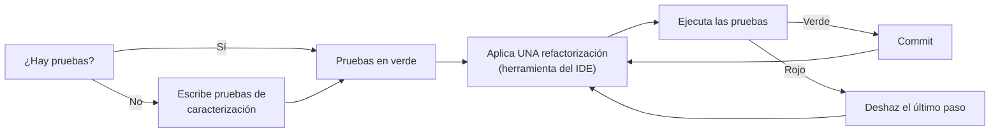

# 1. Refactorización

## Concepto

> **Refactorizar** es modificar la estructura interna del software para hacerlo más fácil de entender y más barato de modificar, **sin cambiar su comportamiento observable**. — Martin Fowler

- Se hace en **pasos pequeños**, cada uno seguro y comprobable.
- No añade funcionalidades ni corrige errores. Si a la vez cambias el comportamiento, ya no es una refactorización (y no sabrás qué ha roto qué).
- Es una actividad **continua**, no una fase: «deja el código mejor de lo que lo encontraste».

### Ventajas

- Código más legible y fácil de mantener, lo que reduce la deuda técnica.
- Diseños más robustos y menos duplicación.
- Facilita encontrar errores y añadir funcionalidades.

### Limitaciones y riesgos

- **Sin pruebas, refactorizar es arriesgado**: no hay forma de saber si el comportamiento ha cambiado.
- Cambiar **interfaces públicas** (API) afecta a quien las usa: hay que coordinar o mantener compatibilidad (`@Deprecated`).
- Código acoplado a **bases de datos** o a **sistemas externos**: la refactorización interna no basta.
- **Coste frente a beneficio**: a veces es más rentable reescribir un módulo, o no tocarlo si no va a cambiar.
- Puede empeorar el **rendimiento** en casos puntuales (más llamadas a métodos). Primero claridad, y después se optimiza donde se mida un problema.

## Refactorización y pruebas



Una **prueba de caracterización** captura el comportamiento **actual** de un código heredado (aunque no sepas si es «correcto»), para poder refactorizarlo sin cambiarlo. Es el primer paso con código sin pruebas, como [`NotasNoEstructurado.java`](../recursos/up1/NotasNoEstructurado.java).

## Malos olores (*code smells*)

| Olor | Síntoma | Refactorización típica |
|------|---------|------------------------|
| **Método largo** | Hace muchas cosas; tiene comentarios que separan bloques | Extraer método |
| **Clase grande** | Demasiados atributos y responsabilidades | Extraer clase |
| **Código duplicado** | El mismo fragmento en varios sitios | Extraer método; subir a la superclase |
| **Lista de parámetros larga** | `crear(a, b, c, d, e, f)` | Introducir objeto parámetro |
| **Números mágicos** | `if (nota >= 5)`, `precio * 0.21` | Sustituir por una constante con nombre |
| **Nombres poco claros** | `n1`, `aux`, `hacer()` | Renombrar |
| **Condicionales por tipo** | `if (tipo.equals("A")) … else if (tipo.equals("B")) …` | Sustituir condicional por polimorfismo |
| **Envidia de funcionalidad** | Un método usa más los datos de otra clase que los de la suya | Mover método |
| **Obsesión por los primitivos** | Teléfonos, DNI o importes como `String` o `double` | Sustituir valor por objeto |
| **Comentarios que explican el código** | El código no se entiende sin ellos | Extraer método o variable con nombre explicativo |

## Catálogo de refactorizaciones más usuales

| Refactorización | IntelliJ IDEA | VS Code (Java) |
|-----------------|:-------------:|:--------------:|
| **Renombrar** (variable, método, clase) | ++shift+f6++ | ++f2++ |
| **Extraer método** | ++ctrl+alt+m++ | ++ctrl+shift+r++ → *Extract to method* |
| **Extraer variable** | ++ctrl+alt+v++ | *Extract to local variable* |
| **Extraer constante** | ++ctrl+alt+c++ | *Extract to constant* |
| **Extraer campo** | ++ctrl+alt+f++ | *Extract to field* |
| **Extraer parámetro** | ++ctrl+alt+p++ | — |
| **Integrar** (*inline*) variable o método | ++ctrl+alt+n++ | *Inline* |
| **Cambiar firma** | ++ctrl+f6++ | *Change signature* |
| **Mover** clase o miembro | ++f6++ | *Move* |
| **Encapsular campos** (*getters/setters*) | *Refactor → Encapsulate Fields* | *Source Action → Generate Getters and Setters* |
| **Extraer interfaz / superclase** | *Refactor → Extract Interface / Superclass* | — |
| **Introducir objeto parámetro** | *Refactor → Introduce Parameter Object* | — |

++ctrl+alt+shift+t++ en IntelliJ IDEA (*Refactor This*) muestra las refactorizaciones disponibles en el punto del cursor.

## Ejemplos

### Extraer método y sustituir número mágico

=== "Antes"

    ```java
    double media = (n1 + n2 + n3) / 3;
    System.out.println("La media es: " + media);
    // Aprobado o suspenso
    if (media >= 5) {
        System.out.println("El alumno ha aprobado.");
    } else {
        System.out.println("El alumno ha suspendido.");
    }
    ```

=== "Después"

    ```java
    private static final double NOTA_APROBADO = 5.0;

    double media = calcularMedia(n1, n2, n3);
    System.out.println("La media es: " + media);
    System.out.println(mensajeResultado(media));

    static String mensajeResultado(double media) {
        return media >= NOTA_APROBADO
                ? "El alumno ha aprobado."
                : "El alumno ha suspendido.";
    }
    ```

    Además, `mensajeResultado` ya se puede **probar** con JUnit sin capturar la consola.

### Integrar una variable temporal

=== "Antes"

    ```java
    boolean esMayor = edad >= 18;
    return esMayor;
    ```

=== "Después"

    ```java
    return edad >= 18;
    ```

### Sustituir condicional por polimorfismo

=== "Antes"

    ```java
    double sueldoNeto(Empleado e) {
        if (e.getTipo().equals("DIRECTIVO")) {
            return (e.getBruto() + e.getBeneficios()) * (1 - e.getIrpf());
        } else {
            return e.getBruto() * (1 - e.getIrpf());
        }
    }
    ```

=== "Después"

    ```java
    class Empleado {
        double sueldoNeto() { return getBruto() * (1 - getIrpf()); }
    }
    class Directivo extends Empleado {
        @Override
        double sueldoNeto() { return (getBruto() + beneficios) * (1 - getIrpf()); }
    }
    ```

    Añadir un nuevo tipo de empleado ya no obliga a modificar el `if`: se cumple el **principio abierto/cerrado** (*SOLID*).

### Sustituir valor por objeto

Un teléfono guardado como `String` acaba necesitando validación, prefijo, formato… Al convertirlo en una clase `Telefono` con su propia lógica, `Jugador` deja de crecer sin control.

## Patrones de diseño

Muchas refactorizaciones acaban introduciendo **patrones de diseño**: soluciones probadas a problemas recurrentes (catálogo de Gamma, Helm, Johnson y Vlissides, la «banda de los cuatro», 1994). Algunos habituales: *Strategy* (en lugar de condicionales), *Factory Method* (centralizar la creación), *Observer* (eventos) y *Adapter* (envolver una API externa). Aportan un vocabulario común y diseños reutilizables, aunque no deben forzarse donde no hacen falta.
