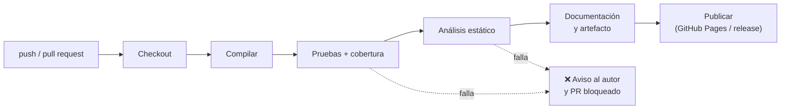

# 4. Integración continua

## Concepto

La **integración continua** (CI, *Continuous Integration*) es la práctica de integrar los cambios de todo el equipo en la rama principal **con frecuencia** (al menos a diario). Cada integración se **verifica automáticamente**: un servidor compila, ejecuta las pruebas y analiza el código. Así los errores se detectan en minutos, cuando todavía son baratos de corregir.

| Práctica | Qué automatiza |
|----------|----------------|
| **Integración continua (CI)** | Construir, probar y analizar cada cambio |
| **Entrega continua (*Continuous Delivery*)** | Además, dejar siempre lista una versión desplegable (el despliegue se lanza a mano) |
| **Despliegue continuo (*Continuous Deployment*)** | Además, desplegar en producción automáticamente si todo pasa |

### Requisitos para que funcione

- Un **repositorio único** con todo lo necesario para construir el proyecto.
- **Construcción automatizada** con una sola orden (`mvn verify`).
- **Pruebas automáticas** fiables y rápidas (UP4).
- Ramas de **vida corta** e integración frecuente (UP3).
- Si la construcción falla, **arreglarla es la prioridad del equipo**.

## El *pipeline*



## Herramientas

| Herramienta | Tipo | Comentario |
|-------------|------|------------|
| **GitHub Actions** | Servicio en la nube integrado en GitHub | Gratuito para repositorios públicos (con límites en privados). **Lo usaremos.** |
| GitLab CI/CD | Integrado en GitLab | Fichero `.gitlab-ci.yml` |
| Jenkins | Servidor propio, libre | Muy extensible; requiere administrarlo |
| CircleCI, Azure Pipelines, Bitbucket Pipelines | Servicios en la nube | |

## GitHub Actions

Un ***workflow*** es un fichero YAML en `.github/workflows/`. Se compone de **eventos** que lo disparan (`on`), **trabajos** (`jobs`) que se ejecutan en máquinas virtuales (`runs-on`) y **pasos** (`steps`), que son comandos (`run`) o **acciones** reutilizables (`uses`).

```yaml title=".github/workflows/ci.yml"
name: CI

on:
  push:
    branches: [main]
  pull_request:
    branches: [main]

jobs:
  build:
    runs-on: ubuntu-latest
    steps:
      - name: Descargar el código
        uses: actions/checkout@v5

      - name: Instalar Java 25
        uses: actions/setup-java@v5
        with:
          distribution: temurin
          java-version: '25'
          cache: maven

      - name: Compilar, probar y medir la cobertura
        run: mvn -B verify

      - name: Comprobar el estilo
        run: mvn -B checkstyle:check

      - name: Generar Javadoc
        run: mvn -B javadoc:javadoc

      - name: Guardar el informe de cobertura
        if: always()
        uses: actions/upload-artifact@v4
        with:
          name: cobertura-jacoco
          path: target/site/jacoco/
```

- La pestaña **Actions** del repositorio muestra cada ejecución y sus registros.
- En un *pull request*, el resultado aparece como **comprobación** (✔ o ✘). Con la protección de rama (UP3) se puede **exigir** que pase antes de fusionar.
- Puedes añadir una **insignia** (*badge*) al README:
  ``

### Publicar la documentación en GitHub Pages

Un segundo *workflow* puede construir el sitio de Zensical (y copiar dentro el Javadoc) y publicarlo en GitHub Pages en cada *push* a `main`. Es lo que hace el *workflow* que genera `zensical new`:

```yaml title=".github/workflows/docs.yml (resumen)"
on:
  push:
    branches: [main]
permissions:
  contents: read
  pages: write
  id-token: write
jobs:
  deploy:
    environment:
      name: github-pages
      url: ${{ steps.deployment.outputs.page_url }}
    runs-on: ubuntu-latest
    steps:
      - uses: actions/configure-pages@v6
      - uses: actions/checkout@v7
      - uses: actions/setup-python@v6
        with:
          python-version: 3.x
      - run: pip install zensical
      - run: zensical build --clean
      - uses: actions/upload-pages-artifact@v5
        with:
          path: site
      - uses: actions/deploy-pages@v5
        id: deployment
```

En *Settings → Pages → Source* elige **GitHub Actions**.

!!! tip "Versiones de las acciones"
    Las acciones se referencian por versión (`@v5`). Revisa de vez en cuando su página en el *Marketplace* de GitHub: Dependabot puede avisarte automáticamente de las actualizaciones.

### Secretos

Las credenciales (*tokens* de SonarQube Cloud, claves de despliegue) **nunca** se escriben en el YAML. Se guardan en *Settings → Secrets and variables → Actions* y se usan como `${{ secrets.NOMBRE }}`.
