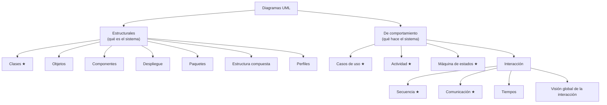

# 1. Orientación a objetos y UML

## Del enfoque estructurado al orientado a objetos

En el **enfoque estructurado**, el programa es un conjunto de funciones que transforman datos que están separados de ellas. En el **enfoque orientado a objetos**, el sistema se modela como un conjunto de **objetos** que combinan datos y comportamiento y colaboran **enviándose mensajes**.

## Conceptos básicos

| Concepto | Definición | En Java |
|----------|------------|---------|
| **Clase** | Plantilla que define los atributos y métodos de un tipo de objetos | `class Alumno { … }` |
| **Objeto (instancia)** | Elemento concreto creado a partir de una clase, con **estado**, **comportamiento** e **identidad** | `Alumno ana = new Alumno("Ana");` |
| **Instanciación** | Crear un objeto a partir de una clase (se ejecuta el constructor) | `new` |
| **Atributo** | Dato que forma parte del estado de un objeto | `private String nombre;` |
| **Método** | Operación que puede realizar un objeto | `public double media()` |
| **Mensaje** | Petición de un objeto a otro para que ejecute un método | `ana.media()` |

## Principios

- **Abstracción**: quedarse con las características esenciales desde el punto de vista del problema. Un `Alumno` en una aplicación de notas no necesita el color de los ojos.
- **Encapsulamiento y ocultación**: el estado interno solo se modifica a través de los métodos de la clase (atributos `private` y métodos públicos que controlan el acceso).
- **Modularidad**: el sistema se descompone en clases y paquetes cohesionados y poco acoplados.
- **Herencia**: una clase (subclase) hereda atributos y métodos de otra (superclase) y puede añadir o redefinir comportamiento. Relación «es un».
- **Polimorfismo**: un mismo mensaje produce comportamientos distintos según la clase real del objeto que lo recibe (`empleado.sueldoNeto()` en un `Empleado` o en un `Directivo`).
- **Gestión de la memoria**: en Java, los objetos que ya no se referencian los libera el **recolector de basura**.

### Ventajas

Reutilización (herencia y composición), mantenimiento más sencillo (cada clase encapsula sus cambios), modelos más cercanos al dominio del problema y facilidad para trabajar en equipo sobre clases independientes.

## UML

**UML** (*Unified Modeling Language*) es el lenguaje **gráfico estándar** para especificar, visualizar, construir y documentar sistemas de software. Nació en 1997 de la unión de los métodos de Booch, Rumbaugh (OMT) y Jacobson (OOSE), y lo mantiene el **OMG** (*Object Management Group*). La versión vigente es **UML 2.5.1**.

UML **no es una metodología**: es un lenguaje que puede usarse con cualquier proceso, en cascada o ágil.

### Por qué modelar

- Para **comunicar** ideas de diseño en el equipo y con el cliente.
- Para **pensar** el diseño antes de programarlo (es más barato cambiar un diagrama que el código).
- Para **documentar** un sistema existente (ingeniería inversa).
- Para **generar** parte del código automáticamente (ingeniería directa).

### Tipos de diagramas (UML 2.5)

★ = diagramas que se estudian en este módulo (UP6 y [UP7](../up7/index.md)).

En la práctica, con unos pocos diagramas (clases, casos de uso, secuencia y actividad) se modela la mayor parte de las aplicaciones habituales.
