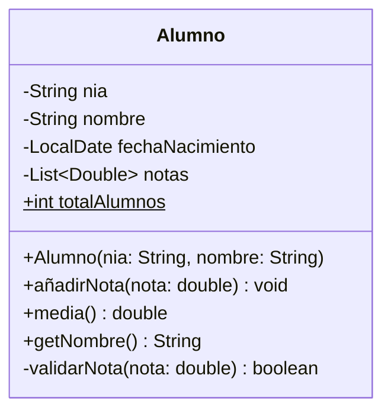
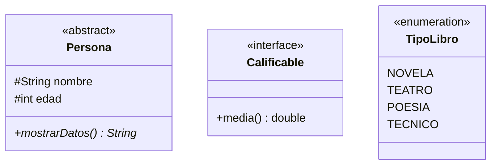
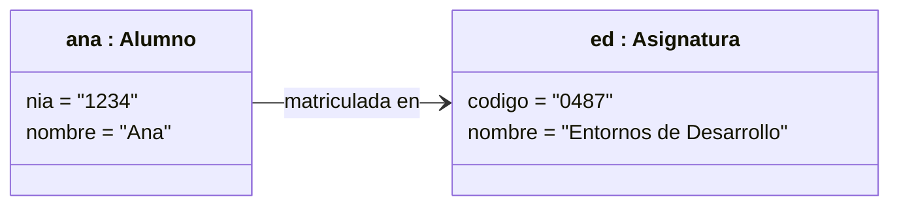

# 2. Notación del diagrama de clases

## La clase

Una clase se dibuja como un rectángulo con tres compartimentos: **nombre**, **atributos** y **operaciones** (métodos).

### Visibilidad

| Símbolo | Visibilidad | Java |
|:-------:|-------------|------|
| `+` | Pública | `public` |
| `-` | Privada | `private` |
| `#` | Protegida | `protected` |
| `~` | De paquete | (sin modificador) |

### Sintaxis

- **Atributo**: `visibilidad nombre : Tipo [multiplicidad] = valorInicial`, por ejemplo `- notas : double [0..*]`.
- **Operación**: `visibilidad nombre(parámetro : Tipo, …) : TipoRetorno`, por ejemplo `+ media() : double`.
- **Estático** (de clase): <u>subrayado</u> (en Mermaid, con `$` al final).
- **Abstracto**: en *cursiva* o con el estereotipo `{abstract}` (en Mermaid, `*` al final del método).
- **Constante**: `{readOnly}` y, por convención, nombre en mayúsculas: `+ NOTA_APROBADO : double = 5 {readOnly}`.

!!! note "Notación de Mermaid y notación estándar"
    Mermaid escribe el tipo **antes** del nombre en los atributos (`-String nombre`) y el tipo de retorno **después** en los métodos (`media() double`). En UML estándar y en PlantUML el tipo va tras dos puntos: `- nombre : String`, `+ media() : double`. Las dos formas se entienden; en los ejercicios a mano usaremos la forma estándar.

## Clases abstractas, interfaces y enumeraciones

- **Clase abstracta**: no se puede instanciar; puede tener métodos abstractos (sin implementación).
- **Interfaz** (`<<interface>>`): un contrato de operaciones que las clases **realizan** (`implements`).
- **Enumeración** (`<<enumeration>>`): un conjunto cerrado de valores.

## Multiplicidad

Indica **cuántos** objetos pueden participar en una relación (o cuántos valores puede tener un atributo):

| Notación | Significado |
|:--------:|-------------|
| `1` | Exactamente uno |
| `0..1` | Cero o uno (opcional) |
| `*` o `0..*` | Cero o muchos |
| `1..*` | Uno o muchos |
| `1..4` | Entre uno y cuatro |

## Diagrama de objetos

Muestra **instancias concretas** en un momento dado: es útil para comprobar si un diagrama de clases es correcto con un ejemplo real. El nombre se escribe subrayado, con el formato `nombreObjeto : Clase`, y los atributos con valores concretos.

