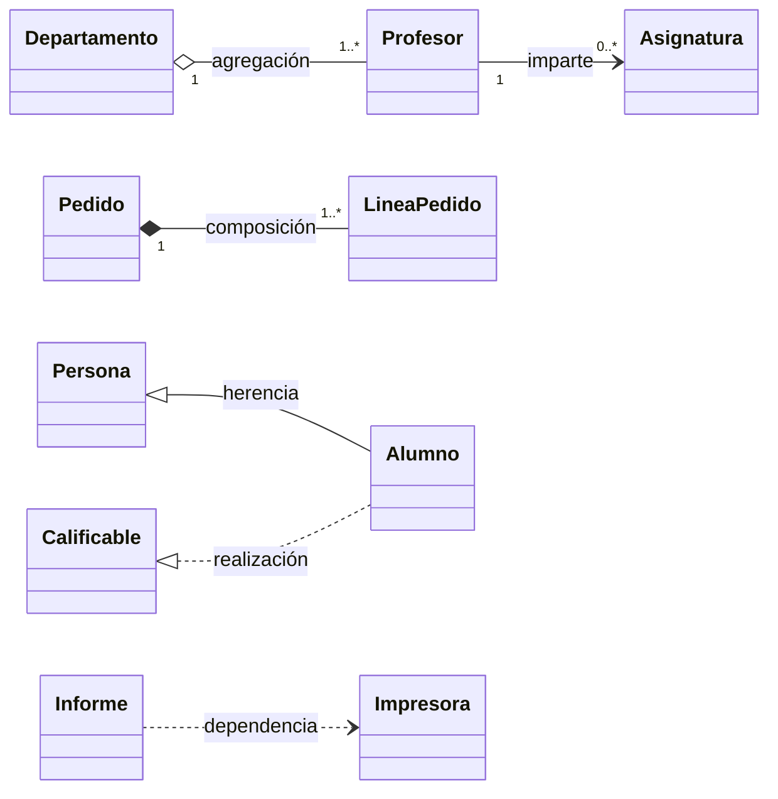
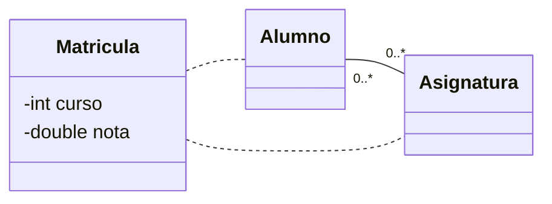

# 3. Relaciones

## Resumen visual



| Relación | Notación | Significado | Ejemplo |
|----------|----------|-------------|---------|
| **Asociación** | Línea continua (con flecha si es navegable) | Los objetos se conocen y colaboran | Profesor **imparte** Asignatura |
| **Agregación** | Rombo **vacío** en el lado del todo | Todo–parte **débil**: las partes pueden existir sin el todo y compartirse | Departamento–Profesor |
| **Composición** | Rombo **relleno** en el lado del todo | Todo–parte **fuerte**: las partes no existen sin el todo y no se comparten. Si se borra el todo, se borran las partes. | Pedido–LíneaPedido |
| **Generalización (herencia)** | Flecha con punta **triangular vacía** hacia la superclase | «Es un» | Alumno es una Persona |
| **Realización** | Línea **discontinua** con punta triangular vacía hacia la interfaz | La clase implementa la interfaz | Alumno implementa Calificable |
| **Dependencia** | Línea **discontinua** con flecha abierta | Uso temporal: un parámetro, una variable local, una llamada | Informe usa Impresora |

## Asociación

### Nombre, roles y multiplicidad

Una asociación puede tener un **nombre** (un verbo: *imparte*), **roles** en cada extremo (*docente*, *materia*) y **multiplicidad** en cada extremo. Se lee en los dos sentidos:

> Un profesor imparte **0 o más** asignaturas; cada asignatura la imparte **1** profesor.

### Navegabilidad

La flecha indica **quién conoce a quién**: `Profesor --> Asignatura` significa que desde un profesor se puede llegar a sus asignaturas (en Java, `Profesor` tiene un atributo `List<Asignatura>`), pero no al revés. Sin flechas, la navegabilidad es bidireccional o no está especificada.

### Clase asociación

Cuando la relación tiene **datos propios**, se modela con una clase asociación. Por ejemplo, la fecha en que un cuidador atiende a una especie, o la nota de un alumno en una asignatura:



En el código, la clase asociación se convierte en una clase normal (`Matricula`) con referencias a las dos clases.

### Asociación reflexiva

Una clase relacionada consigo misma: un empleado **dirige a** otros empleados (`Empleado "1" --> "0..*" Empleado : dirige`).

## Del diagrama al código

=== "Asociación 1 a *"

    ```java
    public class Profesor {
        private final List<Asignatura> asignaturas = new ArrayList<>();
        public void asignar(Asignatura a) { asignaturas.add(a); }
    }
    ```

=== "Composición"

    ```java
    public class Pedido {
        // las líneas se crean dentro del pedido y no se exponen a otras clases
        private final List<LineaPedido> lineas = new ArrayList<>();
        public void añadirLinea(Producto p, int cantidad) {
            lineas.add(new LineaPedido(p, cantidad));
        }
    }
    ```

=== "Agregación"

    ```java
    public class Departamento {
        // los profesores existen fuera del departamento y se reciben desde fuera
        private final List<Profesor> profesores = new ArrayList<>();
        public void incorporar(Profesor p) { profesores.add(p); }
    }
    ```

=== "Herencia y realización"

    ```java
    public abstract class Persona { protected String nombre; }
    public interface Calificable { double media(); }
    public class Alumno extends Persona implements Calificable {
        public double media() { … }
    }
    ```

=== "Dependencia"

    ```java
    public class Informe {
        public void imprimir(Impresora impresora) {   // solo la usa como parámetro
            impresora.enviar(this.toString());
        }
    }
    ```

## Método para pasar de un enunciado a un diagrama

1. **Subraya los sustantivos**: candidatos a clases o atributos. Si tiene datos propios y comportamiento, es una clase; si es un dato simple, es un atributo.
2. **Subraya los verbos**: candidatos a asociaciones o métodos.
3. Busca expresiones de **todo–parte** («está formado por», «tiene») → agregación o composición. Pregúntate: ¿la parte puede existir sin el todo?
4. Busca expresiones de **tipo** («es un», «hay dos tipos de») → herencia.
5. Fija la **multiplicidad** leyendo cada relación en los dos sentidos.
6. Busca **datos que pertenecen a la relación** («fecha en que…») → clase asociación.
7. Comprueba el modelo con un **diagrama de objetos** de un caso real.
