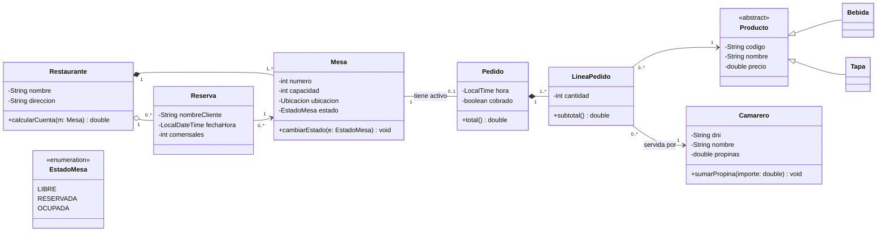

# Tareas de la UP6

Calificación con la [escala común 0–4](../modulo/rubricas.md). Entrega en un repositorio `ed-up6-<usuario>` con los ficheros `.puml` (o los proyectos de la herramienta), las imágenes exportadas y un README que enlace cada ejercicio. En Aules, el enlace.

---

## T6.1 · Leer un diagrama de clases { #t61 }

**RA5 · CE a, c** · Peso: 25 % de las tareas del RA5 · Individual

### Diagrama

*Basado en el ejercicio 6 de la práctica P02-Diagramas de clase del curso 2025-26.*

### Preguntas

1. **(CE a)** Señala en el diagrama un ejemplo de: encapsulamiento, herencia, polimorfismo potencial, abstracción y enumeración. Explica cada uno.
2. **(CE c)** Lee en voz alta (por escrito) **cada relación en los dos sentidos** con su multiplicidad.
3. **(CE c)** ¿Por qué `Restaurante–Mesa` es composición y `Restaurante–Reserva` agregación? ¿Estás de acuerdo? Argumenta.
4. **(CE c)** ¿Se puede instanciar `Producto`? ¿Qué implica para `LineaPedido`?
5. **(CE c)** Con este diagrama, ¿cómo se sabe qué camareros han atendido una mesa para repartir la propina? Escribe la secuencia de navegación.
6. **(CE c)** Dibuja un **diagrama de objetos** con una mesa ocupada con un pedido de 2 líneas (una bebida y una tapa servidas por camareros distintos).
7. **(CE a, c)** Escribe en Java las clases `Pedido` y `LineaPedido` tal y como las describe el diagrama (atributos, relaciones y firmas).

### Rúbrica

| Elemento | Nivel 2 · Correcto y completo | Nivel 3 · Justificado | Nivel 4 · Coherente y bien comunicado |
|----------|-------------------------------|-----------------------|---------------------------------------|
| **CE a** · Conceptos de POO | Ejemplos correctos de los 5 conceptos y código de `Pedido` y `LineaPedido` coherente. | Se explica cómo se manifiesta cada concepto en el diagrama y en el código. | Se aportan mejoras de diseño argumentadas (por ejemplo, encapsular el cambio de estado). |
| **CE c** · Interpretación | Lectura correcta de todas las relaciones, respuestas 3–5 y diagrama de objetos válido. | Las respuestas 3 y 5 se argumentan con la semántica UML. | Detecta limitaciones del modelo y propone cambios. |

---

## T6.2 · Del enunciado al diagrama { #t62 }

**RA5 · CE b, d** · Peso: 45 % de las tareas del RA5 · Individual

*Ejercicios de la práctica P02-Diagramas de clase del curso 2025-26.*

### Enunciado

Elabora con **PlantUML** (o con Visual Paradigm) los diagramas de clases de **cuatro** ejercicios: los ejercicios **1**, **3** y **4** son obligatorios, y el cuarto lo eliges entre el **7** y el **8**. Para cada uno, documenta en el README las decisiones de modelado siguiendo el [método de trabajo](03-relaciones.md#metodo-para-pasar-de-un-enunciado-a-un-diagrama).

??? abstract "1 · Asociación de socios"
    - La asociación tiene varias actividades.
    - De cada persona interesa guardar su DNI, nombre completo y fecha de nacimiento.
    - Cuando se da de alta un nuevo socio, se le asigna un código alfanumérico y se anotan la fecha de alta y las actividades a las que se apunta.
    - Una fecha tiene día, mes y año. El DNI es un número y una letra.
    - Una actividad tiene un nombre, un día (lunes, martes…), una hora de realización y un encargado, que es una persona.

??? abstract "3 · Empresa, empleados y clientes"
    - De la empresa queremos conocer su nombre.
    - De los empleados queremos guardar su sueldo bruto y el porcentaje de IRPF, y calcular el sueldo neto (*sueldoNeto = sueldoBruto − sueldoBruto · irpf*).
    - De los clientes queremos guardar su teléfono.
    - Clientes y empleados tienen en común la edad y el nombre.
    - Los directivos son un tipo de empleado que cobra beneficios. De ellos queremos conocer su categoría y su sueldo neto (*(sueldoBruto + beneficios) − (sueldoBruto + beneficios) · irpf*).
    - Queremos un método que obtenga todos los datos de cada persona.
    - La empresa tiene empleados y directivos (4 como máximo) y tiene clientes. Los empleados solo trabajan en la empresa.
    - Los directivos tienen varios empleados a su cargo y un empleado solo depende de un directivo.

??? abstract "4 · Biblioteca"
    - Un libro tiene título, autor, tejuelo y tipo (novela, teatro, poesía, técnico…; es una enumeración).
    - Los autores tienen nombre, nacionalidad y fecha de nacimiento.
    - De los libros hay copias, con identificador, editorial, año de publicación y estado (prestado, retraso, biblioteca o reparación; es una enumeración).
    - Los lectores tienen número de socio, nombre, teléfono y dirección, y pueden tener un máximo de 3 libros.
    - Un libro se presta un máximo de 30 días. Por cada día de retraso se impone una multa de 2 días sin poder sacar libros.

??? abstract "7 · Zoo"
    - El zoo está formado por varias zonas, definidas por su nombre y su extensión.
    - De las especies se quiere conocer el nombre común, el nombre científico y una descripción general. Una especie está en una única zona y en una zona hay varias especies.
    - Una especie puede vivir en hábitats distintos y un hábitat puede contener especies diferentes. Un hábitat se define por su nombre, clima, tipo de vegetación predominante y el continente o continentes donde se presenta.
    - Los itinerarios tienen código, duración, longitud, número máximo de visitantes y número de especies que se pueden ver. Recorren varias zonas y una zona puede ser recorrida por varios itinerarios.
    - Hay dos tipos de empleados, guías y cuidadores, con nombre, dirección, teléfono y fecha de ingreso.
    - Un guía puede llevar más de un itinerario y un itinerario puede asignarse a guías diferentes en días diferentes. Dado un guía, se quiere saber qué itinerarios lleva.
    - Un cuidador puede encargarse de varias especies y una especie puede tener varios cuidadores. Hay que anotar la fecha en que un cuidador atiende a una especie. Dada una especie, se quiere saber qué cuidadores la han atendido.

??? abstract "8 · Seguridad bancaria"
    - Cada banco tiene un código y la dirección de su sede central, y tiene sucursales con código, dirección y número de empleados.
    - Una sucursal puede contratar vigilantes jurados (código y edad). Un vigilante puede ser contratado por sucursales distintas, de bancos distintos. Hay que guardar la fecha de contratación y si se contrató armado o no.
    - Se quiere controlar a las personas detenidas por atracar sucursales (código y nombre), que pueden estar integradas en bandas (código y número de miembros).
    - Hay que controlar las fechas en que cada atracador ha atracado una sucursal. Un atracador puede atracar varias sucursales y una sucursal puede ser atracada por varios atracadores.
    - Un juez (código, nombre y años de servicio) se encarga de cada caso. Un atracador puede ser juzgado por diferentes delitos y, por tanto, por jueces distintos. Hay que guardar si fue condenado y, en su caso, la duración de la condena.

### Rúbrica

| Elemento | Nivel 2 · Correcto y completo | Nivel 3 · Justificado | Nivel 4 · Coherente y bien comunicado |
|----------|-------------------------------|-----------------------|---------------------------------------|
| **CE d** · Diagramas a partir de especificaciones | Los 4 diagramas recogen todas las clases, atributos, métodos y relaciones del enunciado, con multiplicidades correctas. | Cada decisión dudosa (agregación o composición, atributo o clase, clase asociación) se razona en el README. | Notación impecable y homogénea; diagramas legibles y comprobados con un diagrama de objetos. |
| **CE b** · Herramienta | Diagramas hechos con PlantUML o Visual Paradigm, exportados como imagen y versionados. | Se explica la elección de la herramienta y sus ventajas e inconvenientes. | Uso avanzado (paquetes, notas, estilos) e integración en la documentación (README o sitio de Zensical). |

---

## T6.3 · Ingeniería directa e inversa { #t63 }

**RA5 · CE e, f** · Peso: 30 % de las tareas del RA5 · Individual

### Enunciado

1. **Generar código (CE e).** Con **Visual Paradigm Community Edition**, dibuja el diagrama del ejercicio **4 (Biblioteca)** de la T6.2 y genera el código Java. Analiza el resultado: ¿cómo ha traducido cada multiplicidad, la composición, la enumeración y los métodos? Completa a mano el cuerpo de `Lector.puedePrestar()` y compílalo.
2. **Ingeniería inversa (CE f).** Aplica ingeniería inversa a **tu proyecto de Hundir la flota** (T3.3) o al proyecto de la UP5, con Visual Paradigm (*Instant Reverse*) o con un *plugin* de IntelliJ IDEA que genere PlantUML. Exporta el diagrama.
3. **Revisión crítica (CE f).** Compara el diagrama generado con el que dibujarías a mano: ¿qué relaciones ha detectado mal o no ha detectado? Corrige el diagrama y explica cada cambio.
4. **Ida y vuelta.** Modifica el código (añade un atributo y un método), repite la ingeniería inversa y comprueba que el diagrama se actualiza.

### Rúbrica

| Elemento | Nivel 2 · Correcto y completo | Nivel 3 · Justificado | Nivel 4 · Coherente y bien comunicado |
|----------|-------------------------------|-----------------------|---------------------------------------|
| **CE e** · Generación de código | Código generado, completado y compilado. | Se analiza la traducción de cada elemento del diagrama al código. | Se valoran las limitaciones de la generación y se proponen convenciones para el equipo. |
| **CE f** · Ingeniería inversa | Diagrama obtenido del código real y exportado. | Revisión crítica correcta: se identifican y corrigen los errores de la herramienta. | Ida y vuelta demostrada; el diagrama corregido se incorpora a la documentación del proyecto. |
