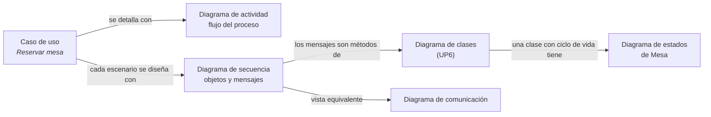

# 1. Tipos de diagramas de comportamiento

| Diagrama | Responde a | Se usa en | Elementos clave |
|----------|------------|-----------|-----------------|
| **Casos de uso** | ¿Quién usa el sistema y para qué? | Análisis de requisitos, comunicación con el cliente | Actores, casos de uso, límite del sistema, `include`, `extend`, generalización |
| **Actividad** | ¿Cómo fluye un proceso o un algoritmo? | Procesos de negocio, detalle de un caso de uso, algoritmos | Acciones, decisiones, bifurcaciones y uniones, calles (*swimlanes*) |
| **Máquina de estados** | ¿Cómo cambia un objeto a lo largo de su vida? | Objetos con ciclo de vida (pedido, mesa, incidencia), protocolos, interfaces | Estados, transiciones con evento [guarda] / acción |
| **Secuencia** (interacción) | ¿Qué mensajes se intercambian los objetos y en qué orden? | Diseño de un escenario de un caso de uso | Líneas de vida, activaciones, mensajes, fragmentos (`alt`, `loop`, `opt`) |
| **Comunicación** (interacción) | ¿Qué objetos colaboran y cómo están enlazados? | Lo mismo que la secuencia, pero centrado en la estructura | Objetos, enlaces, mensajes numerados |
| Tiempos (interacción) | ¿Cuándo cambian los estados en el tiempo? | Sistemas de tiempo real | Líneas de tiempo |
| Visión global de la interacción | ¿Cómo se combinan varias interacciones? | Escenarios complejos | Actividad + referencias a interacciones |

## Cómo se relacionan

Un buen modelo es **coherente**: los mensajes de un diagrama de secuencia son operaciones de las clases, los estados de una máquina de estados corresponden a los valores de un atributo (por ejemplo, la enumeración `EstadoMesa`) y los actores de los casos de uso aparecen como iniciadores de las interacciones.
