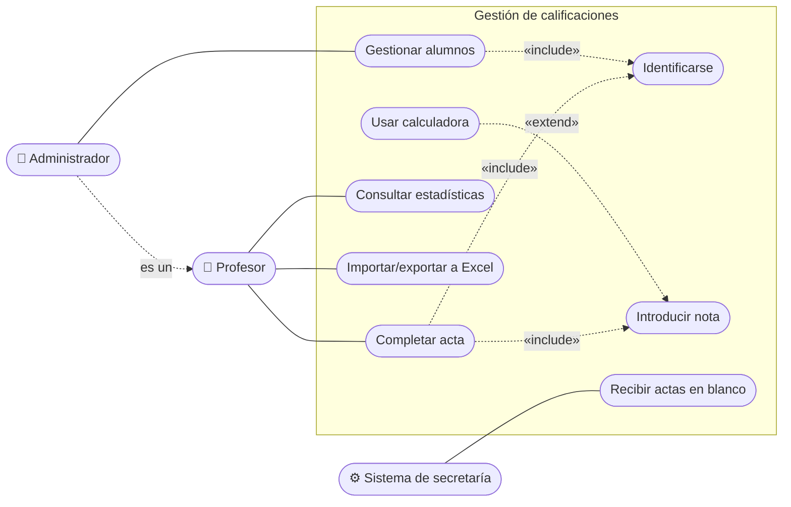

# 2. Casos de uso

Un **diagrama de casos de uso** describe la funcionalidad de un sistema **desde el punto de vista de quien lo usa**, sin entrar en cómo se implementa. Es la herramienta de análisis de requisitos más usada con UML y se entiende sin formación técnica.

## Elementos

| Elemento | Notación | Descripción |
|----------|----------|-------------|
| **Actor** | Monigote con nombre | Un **rol** externo que interactúa con el sistema: una persona (Profesor), otro sistema (Pasarela de pago) o el tiempo (Reloj). No es una persona concreta. |
| **Caso de uso** | Elipse con un verbo en infinitivo | Una funcionalidad que da un **resultado de valor** a un actor: *Introducir notas*, *Reservar mesa*. |
| **Límite del sistema** | Rectángulo con el nombre del sistema | Separa lo que está dentro del sistema de lo que está fuera. |
| **Comunicación (asociación)** | Línea entre actor y caso de uso | El actor participa en el caso de uso. |

## Relaciones

| Relación | Notación | Significado | Ejemplo |
|----------|----------|-------------|---------|
| **Inclusión** `<<include>>` | Flecha discontinua del caso base al incluido | El caso base **siempre** ejecuta el incluido (comportamiento común reutilizado) | *Completar acta* `<<include>>` *Identificarse* |
| **Extensión** `<<extend>>` | Flecha discontinua del caso extensor al base | Comportamiento **opcional** o condicional que amplía el caso base en un **punto de extensión** | *Usar calculadora* `<<extend>>` *Introducir nota* |
| **Generalización** | Flecha de punta triangular vacía | Un actor o un caso de uso especializa a otro | *Administrador* es un *Profesor* con más permisos |

!!! tip "Cómo recordar el sentido de las flechas"
    `include`: **el base necesita** al incluido (la flecha sale del base). `extend`: **el extensor se engancha** al base (la flecha sale del extensor).

## Ejemplo: gestión de calificaciones (parcial)

```text title="calificaciones-casos-uso.puml"
@startuml
left to right direction
actor Profesor
actor Administrador
Administrador --|> Profesor
actor "Sistema de secretaría" as Secretaria <<sistema>>

rectangle "Gestión de calificaciones" {
  usecase "Identificarse" as UC0
  usecase "Completar acta" as UC1
  usecase "Introducir nota" as UC2
  usecase "Usar calculadora" as UC3
  usecase "Consultar estadísticas" as UC4
  usecase "Importar/exportar a Excel" as UC5
  usecase "Gestionar alumnos" as UC6
  usecase "Recibir actas en blanco" as UC7
}

Profesor -- UC1
Profesor -- UC4
Profesor -- UC5
Administrador -- UC6
Secretaria -- UC7
UC1 ..> UC0 : <<include>>
UC1 ..> UC2 : <<include>>
UC3 ..> UC2 : <<extend>>
UC6 ..> UC0 : <<include>>
@enduml
```

Representación aproximada (Mermaid no tiene diagrama de casos de uso nativo):



## Especificación de un caso de uso (escenarios)

El diagrama es solo un índice: cada caso de uso importante se **describe por escrito**. El **escenario principal** es el camino feliz; los **escenarios alternativos** recogen excepciones y variantes.

| Campo | Contenido |
|-------|-----------|
| **Nombre** | CU-02 Introducir nota |
| **Actor principal** | Profesor |
| **Precondiciones** | El profesor se ha identificado y tiene un acta abierta |
| **Escenario principal** | 1. El profesor selecciona un alumno del acta.<br>2. El sistema muestra la casilla de nota.<br>3. El profesor introduce la nota.<br>4. El sistema valida que está entre 0 y 10 y la redondea a dos decimales.<br>5. El sistema guarda la nota y marca al alumno como presentado. |
| **Escenarios alternativos** | 3a. El profesor abre la calculadora (extensión CU-03): el resultado se vuelca en la casilla y se continúa en el paso 4.<br>4a. La nota no es válida: el sistema muestra un error y vuelve al paso 3. |
| **Postcondiciones** | La nota queda registrada en el acta |

## Errores frecuentes

- Casos de uso **demasiado pequeños** (*Pulsar botón Guardar*) o que describen pantallas en lugar de objetivos.
- Usar casos de uso para mostrar el **orden** de los pasos: para eso está el diagrama de actividad.
- Abusar de `include` y `extend`: si no aportan claridad, sobran.
- Poner como actor al propio sistema o a la base de datos interna.
