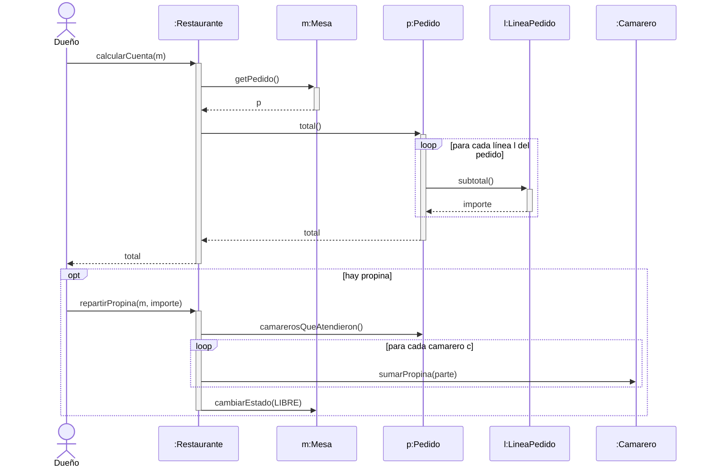
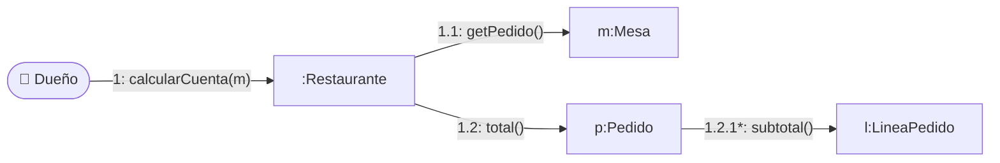

# 3. Secuencia y comunicación

Los diagramas de **interacción** muestran cómo colaboran los objetos para llevar a cabo **un escenario** concreto (normalmente, un escenario de un caso de uso). La secuencia pone el énfasis en el **orden temporal** y la comunicación en los **enlaces** entre objetos.

## Diagrama de secuencia

### Elementos

| Elemento | Notación | Significado |
|----------|----------|-------------|
| **Línea de vida** | Rectángulo `objeto : Clase` con una línea discontinua vertical | Un participante (objeto o actor) a lo largo del tiempo |
| **Activación** | Rectángulo estrecho sobre la línea de vida | Periodo en el que el objeto está ejecutando un método |
| **Mensaje síncrono** | Flecha continua con punta rellena | Llamada a un método; el emisor espera la respuesta |
| **Mensaje asíncrono** | Flecha continua con punta abierta | El emisor no espera (eventos, colas) |
| **Retorno** | Flecha discontinua | Valor devuelto (opcional si es evidente) |
| **Creación** | Mensaje `«create»` hacia la cabecera del nuevo objeto | `new` |
| **Destrucción** | ✕ al final de la línea de vida | El objeto deja de existir |
| **Fragmentos combinados** | Marco con operador | `alt` (si/si no), `opt` (si), `loop` (bucle), `par` (paralelo), `ref` (referencia a otra interacción) |

El **tiempo avanza hacia abajo**. Cada mensaje corresponde a una **operación** de la clase receptora (coherencia con el diagrama de clases).

### Ejemplo: calcular la cuenta de una mesa



### Del código a la secuencia

```java
public double total() {
    double t = 0;
    for (LineaPedido l : lineas) {   // → fragmento loop
        t += l.subtotal();           // → mensaje subtotal() a :LineaPedido
    }
    return t;                        // → retorno
}
```

## Diagrama de comunicación

Muestra **los mismos mensajes** que la secuencia, pero dibujados sobre los **enlaces** entre objetos y **numerados** para indicar el orden (con numeración decimal para las llamadas anidadas: 1, 1.1, 1.2…).



*`*` indica iteración (el mensaje se repite para cada línea). Mermaid no tiene diagrama de comunicación nativo: este es una aproximación; en PlantUML o Visual Paradigm se dibuja con la notación estándar.*

| | Secuencia | Comunicación |
|---|---|---|
| Énfasis | Orden temporal | Estructura de enlaces entre objetos |
| Lectura | De arriba abajo | Siguiendo la numeración |
| Mejor para | Escenarios con muchos mensajes, bucles y alternativas | Ver qué objetos se conocen entre sí |

## Herramientas

```text title="cuenta-secuencia.puml (PlantUML)"
@startuml
actor Dueño
participant ":Restaurante" as R
participant "m:Mesa" as M
participant "p:Pedido" as P
Dueño -> R ++ : calcularCuenta(m)
R -> M ++ : getPedido()
return p
R -> P ++ : total()
loop para cada línea
  P -> P : subtotal de la línea
end
return total
return total
@enduml
```
