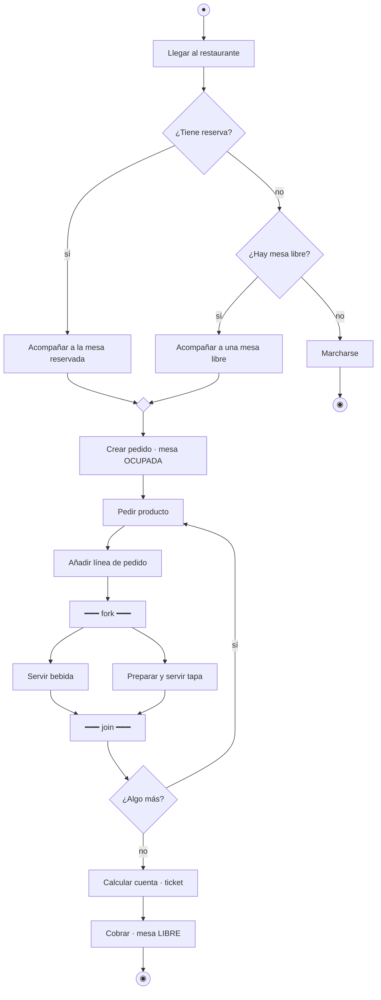

# 4. Diagramas de actividad

Un **diagrama de actividad** representa un **flujo de trabajo**: los pasos de un proceso de negocio, el detalle de un caso de uso o la lógica de un algoritmo. Se parece a un diagrama de flujo, pero añade la **concurrencia** y las **calles** (responsables de cada acción).

## Elementos

| Elemento | Notación | Significado |
|----------|----------|-------------|
| **Nodo inicial** | Círculo relleno | Comienzo del flujo |
| **Acción** | Rectángulo de esquinas redondeadas | Un paso: *Validar nota* |
| **Flujo de control** | Flecha | Orden de ejecución |
| **Decisión** | Rombo con una entrada y varias salidas con **guardas** `[condición]` | Elegir un camino |
| **Fusión** (*merge*) | Rombo con varias entradas y una salida | Reunir caminos alternativos |
| **Bifurcación** (*fork*) | Barra gruesa con una entrada y varias salidas | Iniciar acciones **en paralelo** |
| **Unión** (*join*) | Barra gruesa con varias entradas y una salida | Esperar a que **todas** las ramas paralelas terminen |
| **Nodo final de actividad** | Círculo con un punto relleno dentro | Termina **toda** la actividad |
| **Nodo final de flujo** | Círculo con una ✕ | Termina solo esa rama |
| **Nodo objeto** | Rectángulo | Un dato que se produce o se consume: *Acta [completada]* |
| **Calles** (*swimlanes*) | Particiones verticales u horizontales | Quién realiza cada acción |

## Ejemplo: atender una mesa en el restaurante

```text title="atender-mesa.puml (PlantUML, notación estándar)"
@startuml
|Cliente|
start
:Llegar al restaurante;
|Camarero|
if (¿Tiene reserva?) then (sí)
  :Acompañar a la mesa reservada;
else (no)
  if (¿Hay mesa libre?) then (sí)
    :Acompañar a una mesa libre;
  else (no)
    |Cliente|
    :Marcharse;
    stop
  endif
endif
|Camarero|
:Crear pedido y marcar la mesa OCUPADA;
repeat
  |Cliente|
  :Pedir producto;
  |Camarero|
  :Añadir línea de pedido;
  fork
    :Servir bebida;
  fork again
    |Cocina|
    :Preparar tapa;
    |Camarero|
    :Servir tapa;
  end fork
repeat while (¿Piden algo más?) is (sí) not (no)
|Dueño|
:Calcular cuenta e imprimir ticket;
:Cobrar y marcar la mesa LIBRE;
stop
@enduml
```

Aproximación en Mermaid (sin calles):



## Cuándo usarlo

- Para **entender un proceso de negocio** con el cliente antes de informatizarlo.
- Para detallar el **flujo de un caso de uso** con sus alternativas.
- Para diseñar un **algoritmo** con decisiones y bucles (es el sucesor UML del diagrama de flujo).
- Para mostrar qué tareas pueden hacerse **en paralelo**.
