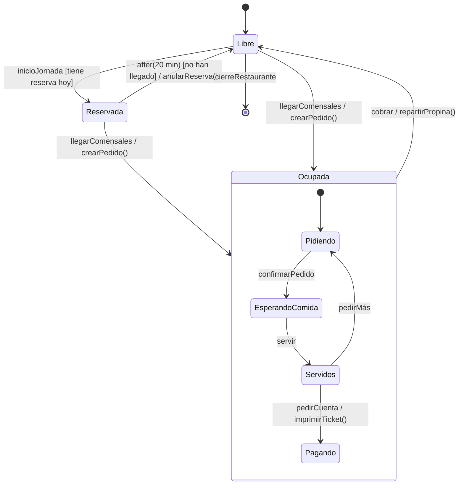

# 5. Diagramas de estados

Un **diagrama de estados** (máquina de estados) describe el **ciclo de vida de un objeto**: los estados por los que pasa y los **eventos** que provocan cada cambio. Se usa para objetos con un comportamiento que depende de su historia: un pedido, una incidencia, una mesa, una conexión o la interfaz de un reproductor.

## Elementos

| Elemento | Notación | Significado |
|----------|----------|-------------|
| **Estado** | Rectángulo redondeado | Situación del objeto durante la que cumple una condición o espera un evento |
| **Estado inicial** | Círculo relleno | Estado al crearse el objeto |
| **Estado final** | Círculo con punto relleno dentro | Fin del ciclo de vida |
| **Transición** | Flecha con la etiqueta `evento [guarda] / acción` | Cambio de estado |
| **Evento** | — | Lo que dispara la transición: una llamada, una señal, el paso del tiempo (`after(20 min)`), un cambio (`when(stock = 0)`) |
| **Guarda** | `[condición]` | La transición solo ocurre si la condición es verdadera |
| **Acción** | `/ acción` | Lo que se ejecuta al hacer la transición (instantáneo) |
| **Actividades internas** | `entry /`, `do /`, `exit /` | Al entrar, mientras se está y al salir del estado |
| **Estado compuesto** | Estado con subestados dentro | Agrupa estados que comparten transiciones |

## Ejemplo: la mesa del restaurante



Se lee así: *una mesa reservada vuelve a estar libre si pasan 20 minutos y los comensales no han llegado, y en ese caso se anula la reserva.*

## Del diagrama al código

Los estados suelen implementarse con una **enumeración** y los eventos con **métodos** que comprueban el estado actual:

```java
public enum EstadoMesa { LIBRE, RESERVADA, OCUPADA }

public class Mesa {
    private EstadoMesa estado = EstadoMesa.LIBRE;   // estado inicial

    public void llegarComensales() {
        if (estado == EstadoMesa.OCUPADA) {
            throw new IllegalStateException("La mesa ya está ocupada");
        }
        estado = EstadoMesa.OCUPADA;
        crearPedido();                                // acción de la transición
    }

    public void cobrar() {
        if (estado != EstadoMesa.OCUPADA) {
            throw new IllegalStateException("No hay nada que cobrar");
        }
        repartirPropina();
        estado = EstadoMesa.LIBRE;
    }
}
```

Cuando el comportamiento de cada estado es muy distinto, se aplica el patrón de diseño ***State***: una clase por estado.

!!! tip "Estados y pruebas"
    Un diagrama de estados es una fuente excelente de **casos de prueba**: una prueba para cada transición válida y otra para cada evento **no permitido** en cada estado (por ejemplo, `cobrar()` en una mesa libre debe lanzar una excepción). Relaciónalo con la UP4.
